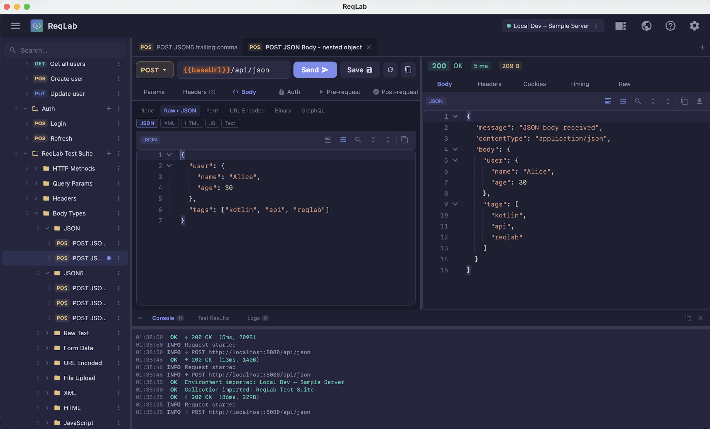
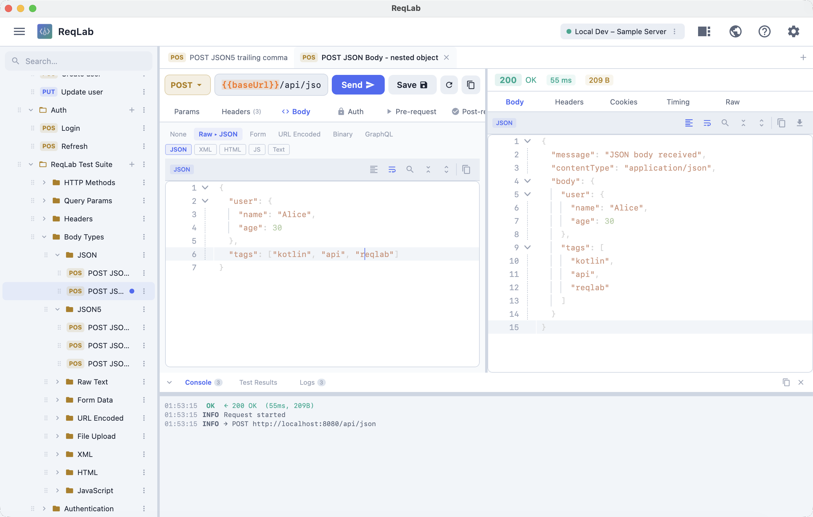
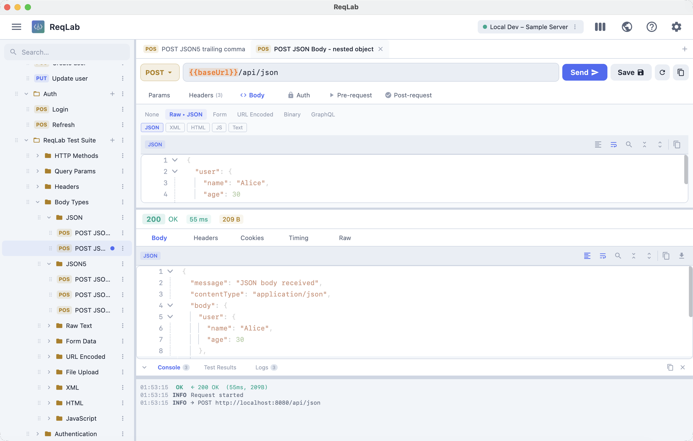

<p align="center">
  
</p>

<h1 align="center">Clapi</h1>

<p align="center">
  <strong>A bullshit-free desktop-first API client built purely with Kotlin.</strong><br/>
  No Electron. No accounts. No telemetry. No cloud lock-in. No bullshit. Completely free.
</p>

[](LICENSE)
[]()
[](https://kotlinlang.org)
[](https://www.jetbrains.com/lp/compose-multiplatform/)
[](https://github.com/snj07/clapi/actions)

---

<p align="center">
  
</p>

<p align="center">
  
  
</p>

---

## What is Clapi?

Clapi is a Kotlin + Compose Multiplatform API client for desktop (macOS, Linux, Windows). It is designed for fast request iteration, scriptable validations, and reproducible API test workflows — running entirely offline with no accounts required.

## Quick Start

Requirements: JDK 17+ (JDK 21 recommended).

```bash
git clone https://github.com/snj07/clapi.git
cd clapi
./gradlew :ui-desktop:run
```

To build and verify the self-contained desktop JAR, start from a clean build:

```bash
./gradlew clean :ui-desktop:packageClapiJar :ui-desktop:verifyPackagedRuntime
```

The `verifyPackagedRuntime` task launches the exact packaged JAR in a headless
shutdown mode, checking that lifecycle and generated runtime classes are present
before the artifact is distributed.

### macOS First Launch Note

Note for macOS users: If you see a warning that the app "cannot be opened because Apple cannot check it for malicious software":

- Right-click the app -> Open -> Open (bypasses the warning once), or
- Go to System Settings -> Privacy & Security -> "Open Anyway" (after attempting to open the app).

### Sample Files to Get Started

You can import these sample fixtures from the repo:

- Collection sample (OpenCollection v1.0.0): [qa-tests/fixtures/clapi-test-collection.json](qa-tests/fixtures/clapi-test-collection.json)
- Environment sample: [qa-tests/fixtures/clapi-test-environment.json](qa-tests/fixtures/clapi-test-environment.json)

The collection includes an **LLM (OpenAI-compatible)** folder, an **SSE** folder, and an **MCP (Model Context Protocol)** folder. Start the sample server, then send **LLM Chat Completions Stream (visible)** or an SSE item to watch events arrive, or open an MCP item and Connect. See [docs/mcp.md](docs/mcp.md).

## Features

### 🚀 HTTP Requests

- Methods: `GET`, `POST`, `PUT`, `PATCH`, `DELETE`, `OPTIONS`, `HEAD`
- URL editing with live query-parameter table synchronisation
- Request headers editor (key/value table)
- Body types: JSON (JSON5 authoring by default; Send converts to strict JSON), GraphQL, form-data, x-www-form-urlencoded, raw text, binary
- Auth: None, Basic, Bearer Token, API Key, JWT
- Retry controls and per-request timeout
- HTTP streaming: SSE (`text/event-stream`) and NDJSON on a single request (OpenAI-style `"stream": true`). Collection items with `Accept: text/event-stream` show an **SSE** badge in the HTTP method color; folder ⋮ → **New SSE Request**
- Copy request as `curl`

### 🧩 Model Context Protocol (MCP)

Clapi brings [Model Context Protocol (MCP)](https://modelcontextprotocol.io/) server testing into the same local-first workspace as your HTTP APIs. Configure a server once, keep it with its collection, and reuse the environments, variable resolution, authentication, and response tooling you already use for REST.


**Connect with confidence**

- Supports Streamable HTTP (MCP 2025-06-18), automatic fallback for legacy servers, Legacy HTTP+SSE (2024-11-05), and local stdio on desktop.
- Keeps connection state, negotiated transport, server identity, and session details visible while you work.
- Resolves `{{variables}}` in endpoints, stdio commands, headers, and authentication. Reuse Basic, Bearer, API Key, or JWT configuration alongside request headers and query parameters.

**Explore the server**

- Search and run tools with schema-driven forms or raw JSON, including server-provided read-only and destructive annotations.
- Browse resources, read or subscribe to supported resource updates, and render prompt messages in the shared Response pane.
- Inspect the complete JSON-RPC exchange in Activity, with protocol diagnostics in Logs and script output in Console.

**Test the host boundary**

- Configure roots, sampling responses, and elicitation behavior in the Client tab.
- Save MCP connections in Clapi collections and carry them through Clapi collection import and export.

[Read the MCP guide →](docs/mcp.md) · [Run the included MCP fixtures →](docs/tests.md#mcp-fixtures)

### 🔐 External Secret Managers (KeePassXC & HashiCorp Vault)

Keep sensitive credentials out of shared collection files:
- **KeePassXC**: Local password manager integration via encrypted proxy communication. Query database entries by URL, refine with custom attribute filters (with `{{variable}}` interpolation), and extract passwords, usernames, TOTPs, or custom fields. Features real-time, non-leaking entry match indicators.
- **HashiCorp Vault**: Read-only KV v2 secret resolution using server URL, mount path, and token.
- **Zero Credential Leaks**: Secret values are strictly ephemeral in memory during request execution and never exported into OpenCollection JSON/YAML files.
- **Zero Idle Footprint**: Proxy communication only activates on-demand for KeePassXC-enabled environments and cleanly disconnects when switching environments.

### 📬 Response Inspection

- Status code, status text, and response headers
- Response body with syntax-highlighted viewer (JSON, XML, HTML, GraphQL, JS)
- Live assembled stream text while a request is in flight; Body shows the assembled answer, RAW shows each SSE/NDJSON event
- Response timing (total, TTFB, time to first/last token, DNS, TCP, TLS, body) and payload size
- Structured pass/fail test result reporting from post-request scripts

### ✏️ Code Editor

A full-featured Compose-native code editor — no WebView, no Electron.

- **Syntax highlighting**: JSON, XML/HTML, GraphQL, JavaScript
- **Code folding**: brace-based (`{ }`, `[ ]`), tag-based, comment-based; Fold All / Unfold All
- **Find / replace**: match count, Previous/Next (`F3`), replace-all as one undo; go to line (`Cmd/Ctrl+G`)
- **Auto-format**: JSON pretty-print, XML/HTML indentation, JavaScript formatting (script editor + body editor)
- Line numbers gutter, 2-space indent guides, matching-bracket highlight, word wrap, monospace font
- Status strip (`Ln X, Col Y`), diagnostic gutter ticks, and full-content rendering for very long lines
- Duplicate / move / comment / select line (see [docs/shortcuts.md](docs/shortcuts.md))
- Virtualized rendering (no jank on responses over 10 MB)
- Full clipboard support (copy, cut, paste, select all) in both edit and read-only modes

### 📜 Scripting

JavaScript pre-request and post-request scripts through the `clapi` namespace.

- **Pre-request**: mutate URL, headers, body, query params, and auth before dispatch
- **Post-request**: assert status, headers, timing, body, assembled stream text, and LLM fields (`finish_reason`, token usage); persist extracted values
- Console logging via `clapi.console.log(...)`
- **HTTP sub-requests** via `clapi.sendRequest()` — make real HTTP calls from within scripts (fetch tokens, look up resources, chain requests)

```javascript
// Pre-request: fetch a token and inject it as a header
clapi.sendRequest({
    url: "https://api.example.com/auth/token",
    method: "POST",
    header: [{ key: "Content-Type", value: "application/json" }],
    body: { mode: "raw", raw: JSON.stringify({ username: "alice", password: "secret" }) }
}, function(err, resp) {
    clapi.request.headers.upsert("Authorization", "Bearer " + resp.json().token)
})
```

See the full guide: [docs/scripts.md](docs/scripts.md)

### 🌱 Variables

Four scopes, all interpolated as `{{variable}}` in URL, headers, body, and auth:

| Scope | API | Lifetime |
|---|---|---|
| Environment | `clapi.environment.*` | Persisted with selected environment |
| Global | `clapi.globals.*` | Persisted workspace-wide |
| Collection | `clapi.collectionVariables.*` | Session-scoped runtime map |
| Request | `clapi.variables.*` | Read-only merged view (request → collection → env → global) |

### ✅ Assertions

Named test blocks with a rich assertion chain:

```javascript
clapi.test("status is 200", () => {
    clapi.expect(clapi.response.status).to.equal(200);
});
```

Assertions: `equal`, `eql`, `include`, `match`, `above`, `below`, `at.least`, `at.most`, `lengthOf`, `property`, `oneOf`, `ok`, `true`, `false`, `null`, `not.*`, and more.

### 📁 Collections & History

- Unlimited collections with nested folders (persisted as top-level OpenCollection Folders in the global OpenCollection document, with environments in `config.environments`)
- Multi-tab request workflow with tab reorder and persistence
- Request history with badge counts and sidebar sync
- Single-collection export and import in OpenCollection format (JSON or YAML), plus Postman Collection v2/v2.1 import (no workspace bundle format)

### 📥 Postman Import

> **⚠️ Experimental feature** — Postman collection and environment import, including automatic `pm.*` / `postman.*` script conversion, is experimental. While most common patterns are supported, complex or unsupported Postman APIs may not convert correctly and may require manual adjustments after import.

Import **Postman Collection v2 / v2.1** and **Postman Environment** files directly.

- All folders, requests, URLs, methods, headers, bodies, and auth types
- `pm.*` script calls are automatically rewritten to `clapi.*` equivalents
- Legacy `postman.*` API calls (pre-v6) are also converted on import
- Disabled headers and variables are skipped on import
- `pm.sendRequest` is **fully supported** — translated to `clapi.sendRequest()` automatically
- `pm.execution.setNextRequest`, `pm.execution.skipRequest`, and `postman.setNextRequest` are translated to `clapi.execution.*`
- See [docs/scripts.md](docs/scripts.md#8-postman-migration-guide) for the full conversion reference

### ⌨️ Keyboard Shortcuts

| Shortcut | Action |
|---|---|
| `⌘ + Enter` / `Ctrl + Enter` | Send request (or cancel in-flight request) |
| `⌘ + Shift + [` / `Ctrl + Shift + [` | Move active tab left |
| `⌘ + Shift + ]` / `Ctrl + Shift + ]` | Move active tab right |
| `⌘ + S` / `Ctrl + S` | Save active request |
| `⌘ + W` / `Ctrl + W` | Close active tab |
| `⌘ + N` / `Ctrl + N` | New request tab |
| `⌘ + ,` / `Ctrl + ,` | Open Settings |

Full shortcut reference (including editor shortcuts): [docs/shortcuts.md](docs/shortcuts.md)

### ❓ In-App Help

Open from the toolbar `Help` icon or via **Settings → Open Help & About**:

- Feature overview and usage flow
- Keyboard shortcuts reference
- Scripting overview
- Version and build info

---

## Documentation

| Document | Description |
|---|---|
| [CHANGELOG.md](CHANGELOG.md) | Release notes |
| [DEVELOPMENT.md](DEVELOPMENT.md) | Build, run, and contribute locally |
| [docs/architecture.md](docs/architecture.md) | Module structure and data flow |
| [docs/editor-architecture.md](docs/editor-architecture.md) | Code editor internals |
| [docs/mcp.md](docs/mcp.md) | MCP client: tools, resources, prompts, Activity, sampling |
| [docs/scripts.md](docs/scripts.md) | Scripting API and variable scopes |
| [docs/shortcuts.md](docs/shortcuts.md) | Keyboard shortcut reference |
| [docs/testing.md](docs/testing.md) | Test strategy and coverage matrix |
| [docs/tests.md](docs/tests.md) | Test run commands |

---

## Contributing

Contributions are welcome. Please use [GitHub Flow](https://guides.github.com/introduction/flow): create a branch, add commits, and open a pull request.

For larger changes, open an issue first to align on approach and scope.

## Continuous Integration

Clapi uses [GitHub Actions](https://github.com/features/actions) for CI. Push to `main` runs the quality gate; tags matching `v*` run the full desktop, network, web, and QA test gate, then build and publish a GitHub Release.

See the workflow: [`.github/workflows/release.yml`](https://github.com/snj07/clapi/actions)

## License

Apache 2.0 — see [LICENSE](LICENSE).
