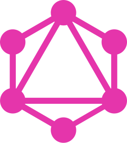
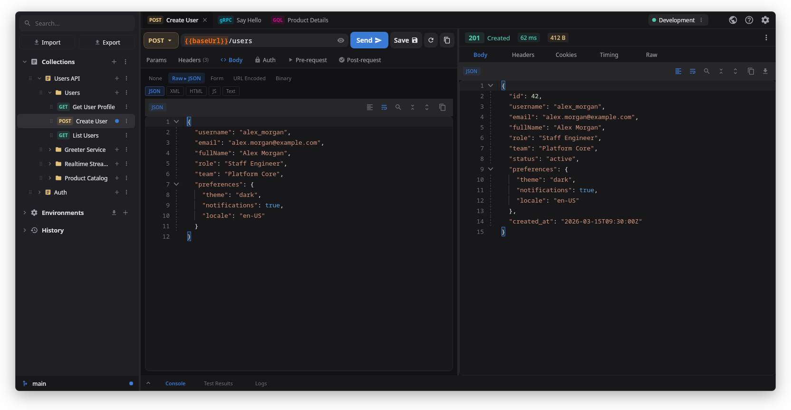

<!-- Modified by MakeForge (2026) -->
<p align="center">
  
</p>

<h1 align="center">
  Clapi
  <br/>
  <a href="https://makeforge.github.io/Clapi/request-types/http/" title="HTTP / REST"><picture><source media="(prefers-color-scheme: dark)" srcset="docs/public/icons/request-types/http-light.svg" /></picture></a>
  &nbsp;&nbsp;
  <a href="https://makeforge.github.io/Clapi/request-types/graphql/" title="GraphQL"></a>
  &nbsp;&nbsp;
  <a href="https://makeforge.github.io/Clapi/request-types/websocket/" title="WebSocket"><picture><source media="(prefers-color-scheme: dark)" srcset="docs/public/icons/request-types/websocket-light.svg" /></picture></a>
  &nbsp;&nbsp;
  <a href="https://makeforge.github.io/Clapi/request-types/grpc/" title="gRPC"></a>
  &nbsp;&nbsp;
  <a href="https://makeforge.github.io/Clapi/request-types/rabbitmq/" title="RabbitMQ (AMQP)"></a>
  &nbsp;&nbsp;
  <a href="https://makeforge.github.io/Clapi/request-types/mcp/" title="Model Context Protocol (MCP)"><picture><source media="(prefers-color-scheme: dark)" srcset="docs/public/icons/request-types/mcp-server-light.svg" /></picture></a>
  &nbsp;&nbsp;
  <a href="https://makeforge.github.io/Clapi/request-types/realtime/" title="Server-Sent Events (SSE)"><picture><source media="(prefers-color-scheme: dark)" srcset="docs/public/icons/request-types/sse-light.svg" /></picture></a>
  <br/>
  <a href="https://makeforge.github.io/Clapi"></a>
  <a href="https://github.com/MakeForge/Clapi/releases/latest"></a>
  <br/>
</h1>

<p align="center">
  <strong>The Bullshit-Free API Client</strong><br/>
<p align="center">
  Open-Source multi-protocol (HTTP, GraphQL, WebSocket, gRPC, RabbitMQ, MCP, SSE) Desktop API development tool with zero telemetry or cloud lock-in, extensive Secret Manager support, Git-native sync and built-in MCP Server for Windows, Linux, macOS for free.
</p>

<p align="center">
  <a href="LICENSE"></a>
  
  <a href="https://github.com/MakeForge/clapi/actions"></a>
</p>

---

<p align="center">
  
</p>


## Quick Start

Clapi ships as a self-contained desktop application (based on Compose Multiplatform backed by rust-based [Nucleus Tao Backend](https://github.com/NucleusFramework/Nucleus)) with native installers. Download the latest release from [GitHub Releases](https://github.com/MakeForge/Clapi/releases/latest) or view the full [Installation Guide](https://makeforge.github.io/Clapi/guide/installation).

### Windows

1. Download `Clapi-Setup-<version>.msi` (or `.exe`) from [GitHub Releases](https://github.com/MakeForge/Clapi/releases/latest).
2. Run the installer and follow the setup wizard.

### Linux

Download the native package matching your distribution from [GitHub Releases](https://github.com/MakeForge/Clapi/releases/latest):

- **Debian / Ubuntu / Linux Mint (`.deb`)**:
  ```bash
  sudo dpkg -i Clapi-<version>-amd64.deb
  sudo apt-get install -f
  ```
- **Fedora / RHEL / openSUSE (`.rpm`)**:
  ```bash
  sudo rpm -i Clapi-<version>-x86_64.rpm
  ```
- **Standalone Tarball (`.tar.gz`)**:
  ```bash
  tar -xzf Clapi-<version>-linux-x64.tar.gz && cd Clapi && ./bin/Clapi
  ```

### macOS

1. Download the latest `.dmg` from [GitHub Releases](https://github.com/MakeForge/Clapi/releases/latest).
2. Open the `.dmg` file and drag **Clapi** into `/Applications`.
3. Launch Clapi from Spotlight (`⌘ + Space`) or Finder.

> **macOS First Launch Note:** If you see a warning that the app "cannot be opened because Apple cannot check it for malicious software", right-click the app → **Open** → **Open**, or go to **System Settings → Privacy & Security → Open Anyway**.

For system requirements, universal Fat JAR instructions, and full setup details, see the [Installation Guide](https://makeforge.github.io/Clapi/guide/installation).

---

## Continuous Integration

Clapi uses [GitHub Actions](https://github.com/features/actions) for CI. Push to `main` runs the quality gate; tags matching `v*` run the full desktop, network, web, and QA test gate, then build and publish a GitHub Release.

See the workflow: [`.github/workflows/release.yml`](https://github.com/MakeForge/clapi/actions)

## License

Apache 2.0 — see [LICENSE](LICENSE) and [NOTICE](NOTICE).
