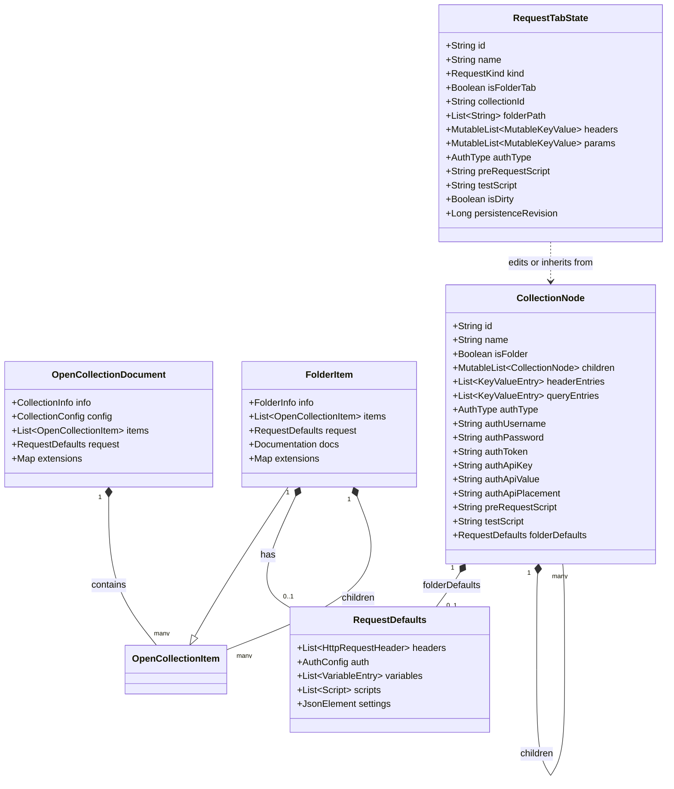

# Data Model: Folder Settings and Request Defaults Inheritance

**Feature Branch**: `003-folder-request-defaults`
**Date**: 2026-11-07
**Status**: Completed

## 1. Core Entities and Relationships



---

## 2. Entity Specifications

### 2.1 `FolderItem` & `RequestDefaults` (Domain Model)
- **Package**: `io.github.crustack.clapi.core.model.opencollection`
- **Fields**:
  - `info: FolderInfo`: Name, type (`"folder"`), seq, tags.
  - `items: List<OpenCollectionItem>`: Child folders or HTTP requests.
  - `request: RequestDefaults?`:
    - `headers: List<HttpRequestHeader>`: Default headers applied to descendant requests.
    - `auth: AuthConfig?`: Default authentication credentials (Basic, Bearer, ApiKey).
    - `variables: List<VariableEntry>`: Folder-scoped variables.
    - `scripts: List<Script>`: Pre-request (`"before-request"`) and Post-request (`"after-response"`) scripts.
    - `settings: JsonElement?`: Optional folder-level settings.
  - `extensions: Map<String, JsonElement>`: Contains `"id"` and internal metadata.

### 2.2 `CollectionNode` (UI Tree State)
- **Package**: `io.github.crustack.clapi.ui.shared.state`
- **Fields for Folder Nodes (`isFolder == true`)**:
  - `id: String`: Unique UUID.
  - `name: String`: Folder display name.
  - `isFolder: Boolean = true`: Indicates this is a folder container.
  - `children: MutableList<CollectionNode>`: Child items.
  - `headerEntries: List<KeyValueEntry>?`: Folder default headers.
  - `queryEntries: List<KeyValueEntry>?`: Folder default query parameters.
  - `authType: AuthType?`: Folder default authentication type (including `NONE`, `BASIC`, `BEARER`, `API_KEY`).
  - `authUsername`, `authPassword`, `authToken`, `authApiKey`, `authApiValue`, `authApiPlacement`: Stored folder credentials.
  - `preRequestScript: String?`: Folder-level pre-request script.
  - `testScript: String?`: Folder-level post-response/test script.

### 2.3 `RequestTabState` (Editor State)
- **Package**: `io.github.crustack.clapi.ui.shared.state`
- **Fields**:
  - `id: String`: Request ID or Folder ID.
  - `name: String`: Title shown on the tab chip.
  - `kind: RequestKind`: Extended to support `RequestKind.FOLDER` (in addition to `HTTP` and `MCP`).
  - `isFolderTab: Boolean`: Computed helper (`kind == RequestKind.FOLDER`).
  - `collectionId: String?`: Parent collection/folder ID.
  - `folderPath: List<String>`: Hierarchy path of ancestor folder IDs/names.
  - `headers: SnapshotStateList<MutableKeyValue>`:
    - User headers: `kind = HeaderKind.USER`
    - System headers: `kind = HeaderKind.SYSTEM`
    - Inherited headers: `kind = HeaderKind.INHERITED` (locked, read-only)
  - `params: SnapshotStateList<MutableKeyValue>`: Query parameters.
  - `authType: AuthType`: Extended with `AuthType.INHERIT`.
  - `preRequestScript: String`: Pre-request script string.
  - `testScript: String`: Post-request script string.

---

## 3. Enumerations & Value Objects

### 3.1 `AuthType`
```kotlin
enum class AuthType {
    NONE,
    BASIC,
    BEARER,
    API_KEY,
    OAUTH2,
    JWT,
    INHERIT, // Inherits auth from parent folder
}
```

### 3.2 `HeaderKind`
```kotlin
enum class HeaderKind {
    SYSTEM,
    USER,
    INHERITED, // Originates from ancestor folder defaults
}
```

### 3.3 `RequestKind`
```kotlin
enum class RequestKind {
    HTTP,
    MCP,
    FOLDER, // Represents an open Folder Settings tab
}
```

---

## 4. State Transitions & Lifecycle

### 4.1 Folder Settings Tab Lifecycle
1. **Open**: User left-clicks folder text in sidebar -> `AppState.openFolder(folderId)`.
   - If tab with `tab.id == folderId && tab.kind == RequestKind.FOLDER` already exists: focus it by setting `activeTabIndex`.
   - Otherwise: create new `RequestTabState(id = folderId, name = folder.name, kind = RequestKind.FOLDER)` populated with the folder's request defaults, add to `openTabs`, set active.
2. **Edit**: User edits headers, params, auth, or scripts in `FolderEditor`.
   - `tab.isDirty` becomes `true`.
   - Tab chip displays dirty indicator (`*`).
3. **Save**: User presses Save (Ctrl+S / Cmd+S / Save button) or auto-save triggers:
   - Updates corresponding `CollectionNode` in `state.collections`.
   - Triggers `state.requestSaveWorkspace()`.
   - Clears `tab.isDirty`.
4. **Close**: User closes tab chip -> removed from `state.openTabs`.

### 4.2 Inherited Settings Resolution in Request Tabs
1. **Request Opened**:
   - `AppState.openRequest(...)` loads request into `RequestTabState`.
   - If request has `folderPath` or parent folder:
     - Collect ancestor `CollectionNode` defaults from root down to direct parent.
     - For each ancestor header: if not present in request-level headers, append as `MutableKeyValue(kind = HeaderKind.INHERITED, keyLocked = true)`.
     - If `tab.authType == AuthType.INHERIT`: resolve effective auth from closest ancestor that has non-empty auth configured.
2. **Request Saved / Sent**:
   - Only `HeaderKind.USER` headers are persisted to the request node in `CollectionNode`.
   - On execution (`sendRequest`), effective headers (inherited + user overrides) are evaluated and dispatched.
