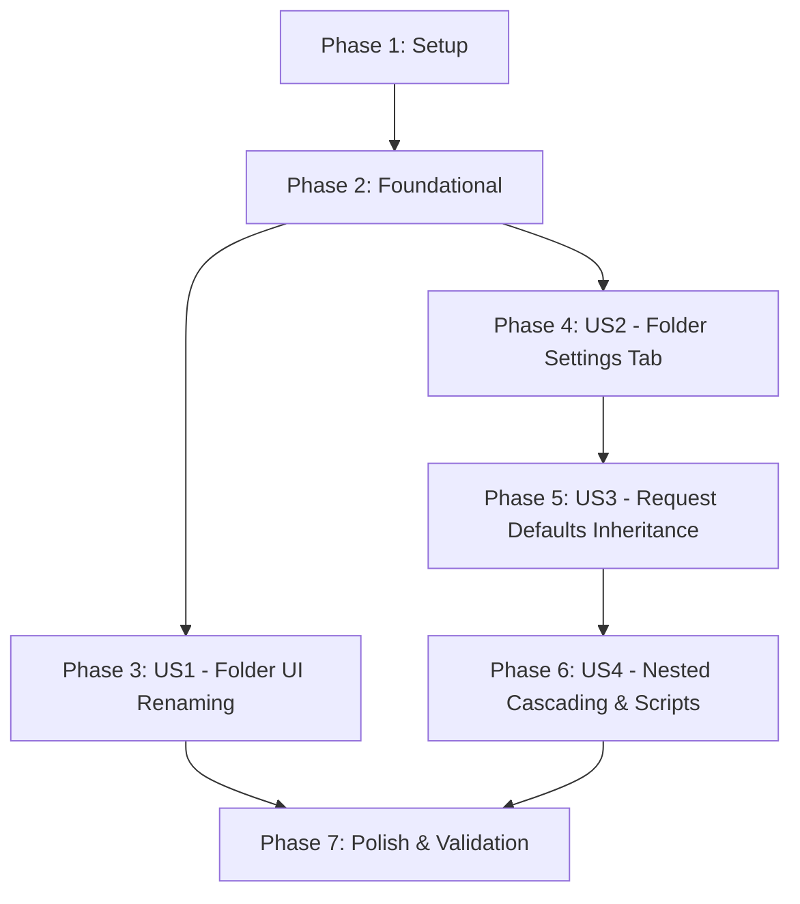

# Tasks: Folder Settings and Request Defaults Inheritance

**Input**: Design documents from `specs/003-folder-request-defaults/`
**Prerequisites**: `plan.md`, `spec.md`, `research.md`, `data-model.md`, `contracts/folder-tab-contract.md`, `contracts/inheritance-resolution-contract.md`, `quickstart.md`
**Organization**: Tasks are grouped by user story to enable independent implementation and testing of each story.

## Format: `[ID] [P?] [Story] Description`

- **[P]**: Can run in parallel (different files, no dependencies)
- **[Story]**: Which user story this task belongs to (`[US1]`, `[US2]`, `[US3]`, `[US4]`)
- Include exact file paths in descriptions

---

## Phase 1: Setup (Shared Infrastructure)

**Purpose**: Project initialization and basic structure

- [x] T001 Inspect and verify multi-module dependencies across `core-model`, `ui-shared`, and `ui-desktop` in settings.gradle.kts

---

## Phase 2: Foundational (Blocking Prerequisites)

**Purpose**: Core model extensions and persistence that MUST be complete before ANY user story can be implemented

⚠️ **CRITICAL**: No user story work can begin until this phase is complete.

- [x] T002 [P] Add `INHERIT` to `AuthType` enum in core-model/src/commonMain/kotlin/io/github/crustack/clapi/core/model/RequestModels.kt
- [x] T003 [P] Add `FOLDER` to `RequestKind` enum in core-model/src/commonMain/kotlin/io/github/crustack/clapi/core/model/McpModels.kt
- [x] T004 [P] Add `INHERITED` to `HeaderKind` enum in ui-shared/src/commonMain/kotlin/io/github/crustack/clapi/ui/shared/state/AppState.kt
- [x] T005 Map `FolderItem.request` (headers, params, auth, scripts) to and from `CollectionNode` in ui-shared/src/commonMain/kotlin/io/github/crustack/clapi/ui/shared/persistence/OpenCollectionModelMapping.kt
- [x] T006 Update `TabsRepository.kt` to serialize and deserialize `RequestKind.FOLDER` tabs preserving folder defaults in ui-shared/src/commonMain/kotlin/io/github/crustack/clapi/ui/shared/persistence/TabsRepository.kt

**Checkpoint**: Core enums and serialization foundations ready. User story implementation can now begin.

---

## Phase 3: User Story 1 - Renaming Collections to Folders in the UI (Priority: P1) 🎯 MVP

**Goal**: Align user-facing UI labels, tooltips, dialogs, and sidebar section headers from "Collections" to "Folders".

**Independent Test**: Launch the UI and verify that sidebar navigation, headers, context menus, and dialogs consistently display "Folder" / "Folders".

### Implementation for User Story 1

- [x] T007 [P] [US1] Update localization strings and translation values for collections to folders in ui-shared/src/commonMain/resources/i18n/en.json, de.json, es.json, fr.json
- [x] T008 [P] [US1] Update `Strings.kt` string accessors for folder terminology in ui-shared/src/commonMain/kotlin/io/github/crustack/clapi/ui/shared/i18n/Strings.kt
- [x] T009 [US1] Update sidebar section headers, context menu labels, and dialog prompts from "Collection" to "Folder" in ui-shared/src/commonMain/kotlin/io/github/crustack/clapi/ui/shared/components/Sidebar.kt
- [x] T010 [P] [US1] Update or add unit tests for folder terminology in ui-desktop/src/desktopTest/kotlin/io/github/crustack/clapi/ui/desktop/components/SidebarCollectionHelpersTest.kt

**Checkpoint**: At this point, User Story 1 is fully functional and all UI references display "Folder".

---

## Phase 4: User Story 2 - Opening and Editing Folder Request Defaults (Priority: P1)

**Goal**: Left-clicking a folder's name in the sidebar opens a dedicated Folder Settings tab to view and edit `FolderItem.request` defaults, focusing existing tabs if already opened.

**Independent Test**: Left-click a folder name in the sidebar; confirm a folder tab opens with a folder icon; edit headers and auth in the folder editor; save; close; reopen and verify persistence.

### Implementation for User Story 2

- [x] T011 [US2] Implement `AppState.openFolder(folderId: String)` to open or focus a `RequestKind.FOLDER` tab in ui-shared/src/commonMain/kotlin/io/github/crustack/clapi/ui/shared/state/AppState.kt
- [x] T012 [US2] Update `CollectionTreeNode` in `Sidebar.kt` to distinguish clicking folder name text (which invokes `openFolder`) vs chevron/folder icon (which toggles expand/collapse) in ui-shared/src/commonMain/kotlin/io/github/crustack/clapi/ui/shared/components/Sidebar.kt
- [x] T013 [US2] Update `RequestTabsBar.kt` to render `Icons.Default.Folder` (instead of method badge) and handle tab close/rename for `RequestKind.FOLDER` tabs in ui-shared/src/commonMain/kotlin/io/github/crustack/clapi/ui/shared/components/RequestTabsBar.kt
- [x] T014 [US2] Create `FolderEditor.kt` composable reusing `EditorTabBar`, `KeyValueEditor`, `AuthEditor`, and `ScriptEditor` for editing `RequestDefaults` in ui-shared/src/commonMain/kotlin/io/github/crustack/clapi/ui/shared/components/FolderEditor.kt
- [x] T015 [US2] Wire `FolderEditor` into `MainScreen.kt` when `activeTab.kind == RequestKind.FOLDER`, omitting URL bar and ResponseViewer in ui-shared/src/commonMain/kotlin/io/github/crustack/clapi/ui/shared/MainScreen.kt
- [x] T016 [US2] Implement save handling for `RequestKind.FOLDER` tabs in `MainScreen.kt` and `AppState.kt` to persist defaults to `CollectionNode` and trigger workspace saving in ui-shared/src/commonMain/kotlin/io/github/crustack/clapi/ui/shared/MainScreen.kt
- [x] T017 [P] [US2] Add unit tests for opening, focusing, and saving folder settings tabs in ui-desktop/src/desktopTest/kotlin/io/github/crustack/clapi/ui/desktop/TabManagementUiTest.kt

**Checkpoint**: Users can open, edit, and persist folder request defaults via dedicated editor tabs.

---

## Phase 5: User Story 3 - Visualizing and Using Inherited Settings in Requests (Priority: P2)

**Goal**: Surface inherited headers and query parameters marked as "Inherited" in child request tabs, and provide an "Inherit" authentication option that resolves from the folder.

**Independent Test**: Configure folder defaults; open a child request; verify inherited headers appear with "Inherited" tags; select "Inherit" auth; execute request and verify effective headers/credentials are dispatched.

### Implementation for User Story 3

- [x] T018 [US3] Implement inherited defaults resolution in `AppState.kt` to traverse ancestor folders along `folderPath` and populate inherited headers and auth defaults in ui-shared/src/commonMain/kotlin/io/github/crustack/clapi/ui/shared/state/AppState.kt
- [x] T019 [US3] Update `KeyValueEditor.kt` to display an "Inherited" badge for `HeaderKind.INHERITED` rows and lock their fields as read-only in ui-shared/src/commonMain/kotlin/io/github/crustack/clapi/ui/shared/components/KeyValueEditor.kt
- [x] T020 [US3] Update `AuthEditor.kt` to include `AuthType.INHERIT` chip when the request is in a folder, showing resolved parent auth in ui-shared/src/commonMain/kotlin/io/github/crustack/clapi/ui/shared/components/AuthEditor.kt
- [x] T021 [US3] Update `RequestExecutor.kt` to merge inherited headers on HTTP dispatch with case-insensitive user overrides, and apply resolved folder authentication when `authType == AuthType.INHERIT` in ui-shared/src/commonMain/kotlin/io/github/crustack/clapi/ui/shared/components/RequestExecutor.kt
- [x] T022 [P] [US3] Add unit tests for inherited headers display, case-insensitive overrides, and auth inheritance in ui-desktop/src/desktopTest/kotlin/io/github/crustack/clapi/ui/desktop/state/RequestTabStateTest.kt

**Checkpoint**: Requests inside folders visually display inherited headers/auth and correctly execute with effective settings.

---

## Phase 6: User Story 4 - Handling Nested Folder Defaults and Script Semantics (Priority: P3)

**Goal**: Support hierarchical cascading across nested folders (parent -> child -> grandchild) and chain folder pre-request scripts with clear TODO annotations for future script scoping.

**Independent Test**: Create nested folders with defaults at each level; open a leaf request; verify combined inherited headers and verify folder pre-request scripts execute before request pre-request scripts.

### Implementation for User Story 4

- [x] T023 [US4] Implement hierarchical inheritance cascading for nested folders in ui-shared/src/commonMain/kotlin/io/github/crustack/clapi/ui/shared/state/AppState.kt
- [x] T024 [US4] Update `RequestExecutor.kt` to execute ancestor folder pre-request scripts before the request pre-request script in ui-shared/src/commonMain/kotlin/io/github/crustack/clapi/ui/shared/components/RequestExecutor.kt
- [x] T025 [US4] Add explicit `// TODO:` comments and documentation in `RequestExecutor.kt` addressing cross-script variable isolation, test script cascading, and error boundary handling in ui-shared/src/commonMain/kotlin/io/github/crustack/clapi/ui/shared/components/RequestExecutor.kt
- [x] T026 [P] [US4] Add unit tests for multi-level nested folder inheritance and script cascading in ui-desktop/src/desktopTest/kotlin/io/github/crustack/clapi/ui/desktop/state/AppStateCollectionTest.kt

**Checkpoint**: Deeply nested folder structures cascade request defaults and scripts seamlessly.

---

## Phase 7: Polish & Cross-Cutting Concerns

**Purpose**: Verification, tests, and documentation across all user stories

- [x] T027 [P] Verify and update OpenCollection import/export tests for folder request defaults in ui-shared/src/commonTest/kotlin/io/github/crustack/clapi/ui/shared/persistence/ImportExportFormDataTest.kt
- [x] T028 [P] Update developer documentation in docs/ explaining folder settings and inheritance rules
- [x] T029 Execute full validation walkthrough following specs/003-folder-request-defaults/quickstart.md

---

## Dependencies & Execution Order

### Phase Dependencies

- **Setup (Phase 1)**: No dependencies - can start immediately.
- **Foundational (Phase 2)**: Depends on Setup (Phase 1). BLOCKS all user stories.
- **User Story 1 (Phase 3)**: Depends on Foundational completion.
- **User Story 2 (Phase 4)**: Depends on Foundational completion. Can run in parallel with or after US1.
- **User Story 3 (Phase 5)**: Depends on User Story 2 completion (requires folder defaults editing in place).
- **User Story 4 (Phase 6)**: Depends on User Story 3 completion (extends inheritance to nested cascades and scripts).
- **Polish (Phase 7)**: Depends on all user stories being complete.

### User Story Dependencies



### Parallel Opportunities

- Foundational tasks T002, T003, T004 can run in parallel (different model/state files).
- US1 tasks T007, T008, T010 can run in parallel with each other.
- US1 (UI terminology) and US2 (Folder tab) can proceed in parallel once Phase 2 completes.
- Unit test tasks T010, T017, T022, T026 can run in parallel once their respective implementations complete.

---

## Parallel Example: Foundational Phase

```bash
# Launch core enum modifications in parallel:
Task: "T002 [P] Add INHERIT to AuthType enum in core-model/src/commonMain/kotlin/io/github/crustack/clapi/core/model/RequestModels.kt"
Task: "T003 [P] Add FOLDER to RequestKind enum in core-model/src/commonMain/kotlin/io/github/crustack/clapi/core/model/McpModels.kt"
Task: "T004 [P] Add INHERITED to HeaderKind enum in ui-shared/src/commonMain/kotlin/io/github/crustack/clapi/ui/shared/state/AppState.kt"
```

---

## Implementation Strategy

### MVP First (User Story 1 & User Story 2)

1. Complete Phase 1: Setup.
2. Complete Phase 2: Foundational (blocking enums and serialization).
3. Complete Phase 3: User Story 1 (rename Collections to Folders).
4. Complete Phase 4: User Story 2 (open and edit folder settings tabs).
5. **STOP and VALIDATE**: Verify folder tab opening and settings editing independently.

### Incremental Delivery

1. Setup + Foundational -> Foundation ready.
2. User Story 1 -> Terminology updated across UI.
3. User Story 2 -> Folder settings tabs functional (MVP!).
4. User Story 3 -> Child requests display and utilize inherited headers & auth.
5. User Story 4 -> Nested folder cascades and script execution chained.
6. Polish -> Full test coverage and quickstart validation.
