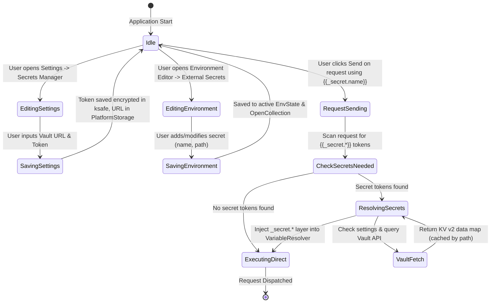

# Data Model: External Secret Variables

This document defines the data structures, relationships, validation rules, and state lifecycles for external secret variables and secret manager integration.

---

## 1. Domain Entities & Schemas

### 1.1 SecretProviderConfig (Application Settings)
Represents global application-level credentials for connecting to an external secret provider. Stored locally in `PlatformStorage` and never exported into collections.

| Field | Type | Required | Default | Storage Mechanism | Description |
|---|---|---|---|---|---|
| `providerType` | String | Yes | `"hashicorp-vault-server"` | Plain `PlatformStorage` | Identifier of the secret provider |
| `serverUrl` | String | Yes | `""` | Plain `PlatformStorage` | Base URL of the Vault server (e.g. `http://127.0.0.1:8200`) |
| `mountPath` | String | No | `"secret"` | Plain `PlatformStorage` | Mount path for the KV v2 engine |
| `namespace` | String | No | `""` | Plain `PlatformStorage` | Vault namespace (optional, enterprise/HCP) |
| `vaultToken` | String | Yes | `""` | Encrypted via `ksafe` (`putSecretString`) | Vault authentication token (`X-Vault-Token`) |

---

### 1.2 OpenCollection ExternalSecrets Schema (`core-model`)

Conforms strictly to OpenCollection v1.0.0 (`$defs/ExternalSecrets`).

```kotlin
package io.github.crustack.clapi.core.model.opencollection

import kotlinx.serialization.Serializable
import kotlinx.serialization.json.JsonContentPolymorphicSerializer
import kotlinx.serialization.json.JsonElement
import kotlinx.serialization.json.jsonObject

@Serializable
data class ExternalSecrets(
    val type: String, // e.g. "hashicorp-vault-server"
    val variables: List<ExternalSecretVariable> = emptyList(),
)

@Serializable(with = ExternalSecretVariableSerializer::class)
sealed interface ExternalSecretVariable {
    val name: String
    val description: Description?
    val disabled: Boolean?
}

@Serializable
data class HashicorpVaultExternalSecret(
    override val name: String,
    val path: String,
    override val description: Description? = null,
    override val disabled: Boolean? = null,
) : ExternalSecretVariable

object ExternalSecretVariableSerializer :
    JsonContentPolymorphicSerializer<ExternalSecretVariable>(ExternalSecretVariable::class) {
    override fun selectDeserializer(element: JsonElement) =
        HashicorpVaultExternalSecret.serializer()
}
```

Updated `Environment` entity:
```kotlin
@Serializable
data class Environment(
    val name: String,
    val color: String? = null,
    val description: Description? = null,
    val variables: List<VariableEntry> = emptyList(),
    val clientCertificates: List<ClientCertificate> = emptyList(),
    val extends: String? = null,
    val dotEnvFilePath: String? = null,
    val externalSecrets: ExternalSecrets? = null,
)
```

---

### 1.3 UI State Entities (`ui-shared/state`)

#### `EnvState`
Extended to maintain reactive external secret declarations:
```kotlin
class EnvState(
    name: String,
    variables: List<MutableKeyValue> = emptyList(),
    var color: String? = null,
    var description: Description? = null,
    var clientCertificates: List<ClientCertificate> = emptyList(),
    var extends: String? = null,
    var dotEnvFilePath: String? = null,
    externalSecretsProvider: String = "hashicorp-vault-server",
    externalSecrets: List<MutableExternalSecret> = emptyList(),
) {
    var name by mutableStateOf(name)
    val variables = mutableStateListOf<MutableKeyValue>().also { it.addAll(variables) }
    var externalSecretsProvider by mutableStateOf(externalSecretsProvider)
    val externalSecrets = mutableStateListOf<MutableExternalSecret>().also { it.addAll(externalSecrets) }
}
```

#### `MutableExternalSecret`
Represents an individual editable row in the Environment Editor dialog:
```kotlin
class MutableExternalSecret(
    name: String = "",
    path: String = "",
    description: String = "",
    enabled: Boolean = true,
) {
    var name by mutableStateOf(name)
    var path by mutableStateOf(path)
    var description by mutableStateOf(description)
    var enabled by mutableStateOf(enabled)
}
```

---

### 1.4 Vault KV v2 Wire Models (`core-network`)

Represents HTTP response payloads from HashiCorp Vault KV v2 secret engine:
```kotlin
package io.github.crustack.clapi.core.network.vault

import kotlinx.serialization.Serializable
import kotlinx.serialization.json.JsonObject

@Serializable
data class VaultKvV2Response(
    val data: VaultKvV2Data,
)

@Serializable
data class VaultKvV2Data(
    val data: JsonObject,
    val metadata: JsonObject? = null,
)
```

---

## 2. Validation Rules

1. **Vault Configuration Validation**:
   - `serverUrl`: Must be a valid HTTP or HTTPS URI. Trailing slashes are automatically trimmed.
   - `mountPath`: Defaults to `"secret"`. Slashes are trimmed.
   - `vaultToken`: Cannot be blank when attempting to resolve Vault secrets.
2. **External Secret Declaration Validation**:
   - `name`: Must be non-blank, trimmed, and valid as a variable identifier (e.g. `client_id`).
   - `path`: Must be non-blank (e.g. `payment/foo`). Leading and trailing slashes are trimmed.
   - `disabled`: If `true`, the secret is excluded from autocomplete suggestions and runtime resolution fails with an explicit error.
3. **Secret Resolution Mapping**:
   - For a secret reference `{{_secret.variable_name}}`:
     1. Matches `name == variable_name` in the active environment's `externalSecrets`.
     2. Queries the secret path in HashiCorp Vault.
     3. Looks up `variable_name` inside `data.data`.
     4. If `data.data` contains exactly one key-value pair, that single value is accepted as a fallback if `variable_name` does not match the key.
     5. If not found, throws `IllegalStateException("Secret 'variable_name' not found at Vault path 'path'")`.

---

## 3. State Transitions & Lifecycle


