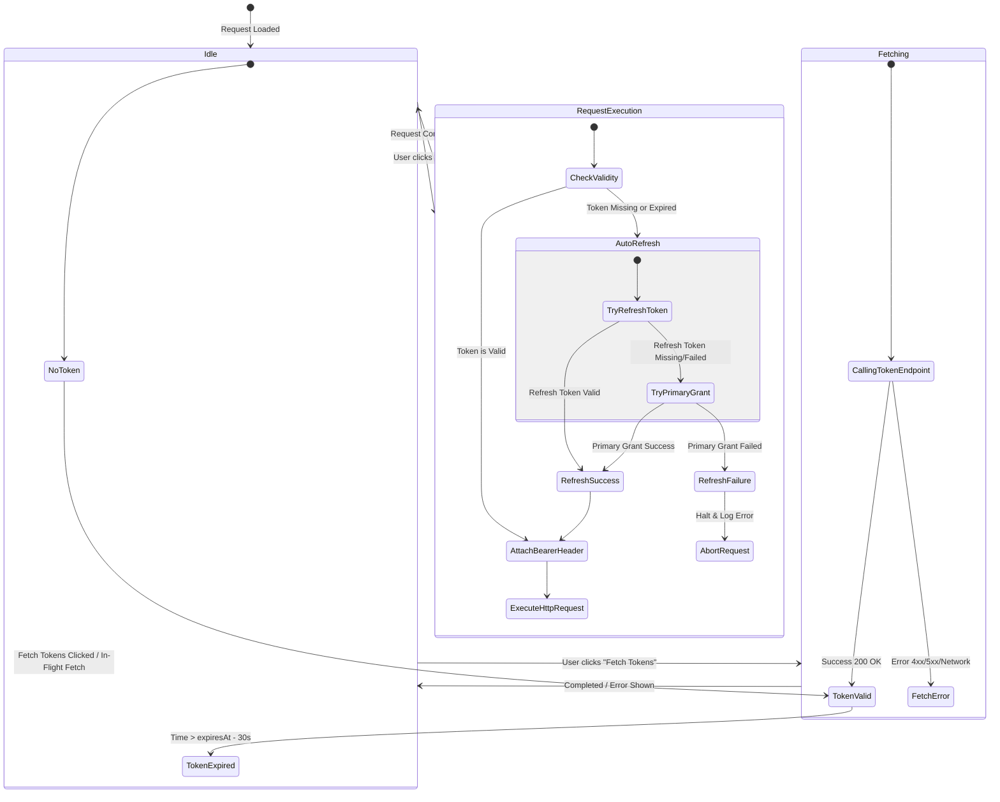

# Data Model: OAuth2 Authentication

## 1. Domain Models (`core-model`)

The canonical OpenCollection OAuth2 models are defined in `io.github.crustack.clapi.core.model.opencollection.OpenCollectionAuth.kt`.

### 1.1 `AuthOAuth2`
Represents the persisted authentication configuration in OpenCollection documents:
```kotlin
@Serializable
data class AuthOAuth2(
    override val type: AuthType = AuthType.OAUTH2,
    val flow: OAuth2Flow = OAuth2Flow.CLIENT_CREDENTIALS,
    val accessTokenUrl: String? = null,
    val refreshTokenUrl: String? = null,
    val authorizationUrl: String? = null,
    val redirectUri: String? = null,
    val credentials: OAuth2ClientCredentials? = null,
    val resourceOwner: OAuth2ResourceOwner? = null,
    val scope: String? = null,
    val tokenConfig: OAuth2TokenConfig? = null,
    val settings: OAuth2Settings? = null
) : AuthConfig
```

### 1.2 Sub-models & Enums
- **`OAuth2Flow`**:
  - `CLIENT_CREDENTIALS` (`"client_credentials"`)
  - `RESOURCE_OWNER_PASSWORD_CREDENTIALS` (`"resource_owner_password_credentials"`)
  - `AUTHORIZATION_CODE` (`"authorization_code"`)
  - `IMPLICIT` (`"implicit"`)
- **`OAuth2CredentialsPlacement`**:
  - `BASIC_AUTH_HEADER` (`"basic_auth_header"`)
  - `BODY` (`"body"`)
- **`OAuth2ClientCredentials`**:
  - `clientId: String? = null`
  - `clientSecret: String? = null`
  - `placement: OAuth2CredentialsPlacement = OAuth2CredentialsPlacement.BASIC_AUTH_HEADER`
- **`OAuth2ResourceOwner`**:
  - `username: String? = null`
  - `password: String? = null`
- **`OAuth2TokenConfig`**:
  - `id: String? = null`
  - `placement: JsonElement? = null`
  - `source: OAuth2TokenSource = OAuth2TokenSource.ACCESS_TOKEN`
- **`OAuth2Settings`**:
  - `autoFetchToken: Boolean? = null`
  - `autoRefreshToken: Boolean? = null`

---

## 2. Runtime Token State (`core-network`)

### 2.1 `OAuth2TokenResponse`
Deserialized payload returned by standard RFC 6749 token endpoints:
```kotlin
@Serializable
data class OAuth2TokenResponse(
    @SerialName("access_token") val accessToken: String,
    @SerialName("token_type") val tokenType: String = "Bearer",
    @SerialName("expires_in") val expiresIn: Long? = null,
    @SerialName("refresh_token") val refreshToken: String? = null,
    @SerialName("id_token") val idToken: String? = null,
    @SerialName("scope") val scope: String? = null
)
```

### 2.2 `OAuth2TokenState`
In-memory representation of active session tokens:
```kotlin
data class OAuth2TokenState(
    val accessToken: String,
    val tokenType: String = "Bearer",
    val refreshToken: String? = null,
    val idToken: String? = null,
    val scope: String? = null,
    val expiresAtEpochMs: Long? = null,
    val fetchedAtEpochMs: Long = currentTimeMillis()
) {
    /**
     * Checks if token is valid and not nearing expiration.
     * @param bufferMs Safety buffer in milliseconds (default: 30,000ms / 30s)
     */
    fun isValid(bufferMs: Long = 30_000L): Boolean {
        if (accessToken.isBlank()) return false
        val expiresAt = expiresAtEpochMs ?: extractJwtExpiryEpochMs(accessToken)
        return expiresAt == null || expiresAt > (currentTimeMillis() + bufferMs)
    }
}
```

---

## 3. Application & UI State (`ui-shared`)

### 3.1 Properties added to `RequestTabState` & `CollectionNode`
To manage OAuth2 in the UI and during execution:
- `var authOAuth2Flow: OAuth2Flow = OAuth2Flow.CLIENT_CREDENTIALS`
- `var authOAuth2AccessTokenUrl: String = ""`
- `var authOAuth2RefreshTokenUrl: String = ""`
- `var authOAuth2AuthorizationUrl: String = ""`
- `var authOAuth2RedirectUri: String = ""`
- `var authOAuth2Scope: String = ""`
- `var authOAuth2ClientId: String = ""`
- `var authOAuth2ClientSecret: String = ""`
- `var authOAuth2CredentialsPlacement: OAuth2CredentialsPlacement = OAuth2CredentialsPlacement.BASIC_AUTH_HEADER`
- `var authOAuth2Username: String = ""`
- `var authOAuth2Password: String = ""`
- `var authOAuth2AccessToken: String = ""`
- `var authOAuth2RefreshToken: String = ""`
- `var authOAuth2IdToken: String = ""`
- `var authOAuth2ExpiresAtEpochMs: Long? = null`
- `var authOAuth2IsFetching: Boolean = false`
- `var authOAuth2FetchError: String? = null`

---

## 4. Lifecycle & State Transitions



---

## 5. Persistence Mapping Rules

1. **Mapping to OpenCollection (`OpenCollectionModelMapping.kt`)**:
   - When saving a request or folder/collection defaults with `authType == AuthType.OAUTH2`:
     - Creates `AuthOAuth2` with non-empty fields.
     - Ephemeral tokens (`authOAuth2AccessToken`, `authOAuth2RefreshToken`, etc.) are **not** written to the collection JSON file to protect credentials.
2. **Mapping from OpenCollection**:
   - When loading an `AuthOAuth2` block from JSON:
     - Populates corresponding `authOAuth2*` properties on `RequestTabState` or `CollectionNode`.
     - Sets `authType = AuthType.OAUTH2`.
