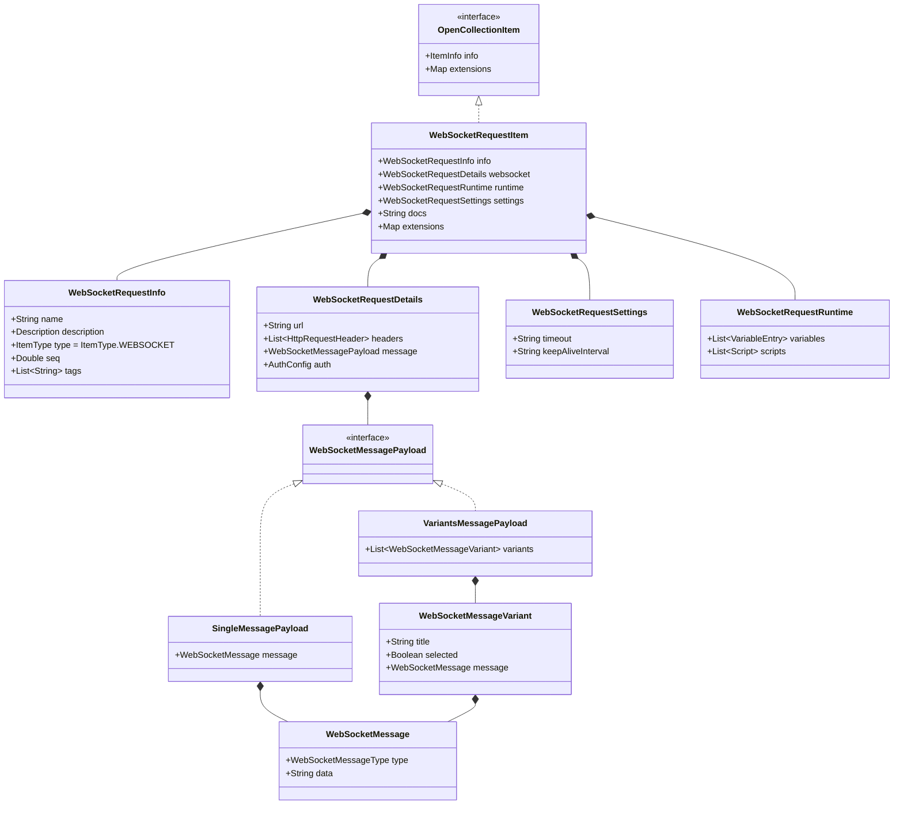

# Data Model: WebSocket Requests

**Feature**: `013-websocket-requests`
**Date**: 2026-11-10

## 1. OpenCollection Schema Domain Models (`core-model`)



### 1.1 `WebSocketMessageType` Enum
```kotlin
@Serializable
enum class WebSocketMessageType(val value: String) {
    @SerialName("text") TEXT("text"),
    @SerialName("json") JSON("json"),
    @SerialName("xml") XML("xml"),
    @SerialName("binary") BINARY("binary");

    companion object {
        fun fromValue(value: String?): WebSocketMessageType =
            entries.firstOrNull { it.value.equals(value, ignoreCase = true) } ?: TEXT
    }
}
```

### 1.2 `WebSocketMessage` & `WebSocketMessageVariant`
```kotlin
@Serializable
data class WebSocketMessage(
    val type: WebSocketMessageType = WebSocketMessageType.TEXT,
    val data: String = "",
)

@Serializable
data class WebSocketMessageVariant(
    val title: String,
    val selected: Boolean = false,
    val message: WebSocketMessage,
)
```

### 1.3 `WebSocketMessagePayload`
```kotlin
@Serializable(with = WebSocketMessagePayloadSerializer::class)
sealed interface WebSocketMessagePayload {
    data class Single(val message: WebSocketMessage) : WebSocketMessagePayload
    data class Variants(val variants: List<WebSocketMessageVariant>) : WebSocketMessagePayload
}
```

### 1.4 `WebSocketRequestSettings` & `WebSocketRequestRuntime`
```kotlin
@Serializable
data class WebSocketRequestSettings(
    val timeout: String? = null,           // e.g. "inherit" or numeric string
    val keepAliveInterval: String? = null, // e.g. "inherit" or numeric string
)

@Serializable
data class WebSocketRequestRuntime(
    val variables: List<VariableEntry> = emptyList(),
    val scripts: List<Script> = emptyList(),
)
```

### 1.5 `WebSocketRequestDetails` & `WebSocketRequestItem`
```kotlin
@Serializable
data class WebSocketRequestDetails(
    val url: String,
    val headers: List<HttpRequestHeader> = emptyList(),
    val message: WebSocketMessagePayload? = null,
    val auth: AuthConfig? = null,
)

@Serializable
data class WebSocketRequestInfo(
    override val name: String,
    override val description: Description? = null,
    override val type: ItemType = ItemType.WEBSOCKET,
    override val seq: Double? = null,
    override val tags: List<String> = emptyList(),
) : ItemInfo

@Serializable
data class WebSocketRequestItem(
    override val info: WebSocketRequestInfo,
    val websocket: WebSocketRequestDetails,
    val runtime: WebSocketRequestRuntime? = null,
    val settings: WebSocketRequestSettings? = null,
    val docs: String? = null,
    @Transient override val extensions: Map<String, JsonElement> = emptyMap(),
) : OpenCollectionItem
```

---

## 2. In-Memory UI State Models (`ui-shared`)

### 2.1 Extension of `RequestKind`
```kotlin
enum class RequestKind {
    HTTP, MCP, FOLDER, GRPC, COLLECTION, WEBSOCKET
}
```

### 2.2 `WebSocketLogMessage`
```kotlin
data class WebSocketLogMessage(
    val id: String = generateUuid(),
    val timestamp: Long = currentTimeMillis(),
    val direction: MessageDirection, // SENT or RECEIVED
    val format: WebSocketMessageType,
    val payload: String,
    val byteLength: Long,
)
```

### 2.3 `RequestTabState` Additions
```kotlin
// In RequestTabState:
var webSocketConnectionState by mutableStateOf(ConnectionState.DISCONNECTED)
val webSocketLogMessages = mutableStateListOf<WebSocketLogMessage>()
val webSocketMessageVariants = mutableStateListOf<WebSocketMessageVariant>()
var activeWebSocketVariantIndex by mutableStateOf(0)
var webSocketMessageFormat by mutableStateOf(WebSocketMessageType.TEXT)
var webSocketTimeout by mutableStateOf<String?>("inherit")
var webSocketKeepAliveInterval by mutableStateOf<String?>("inherit")
var selectedWebSocketSubTab by mutableStateOf(WebSocketEditorTab.MESSAGE)
```
