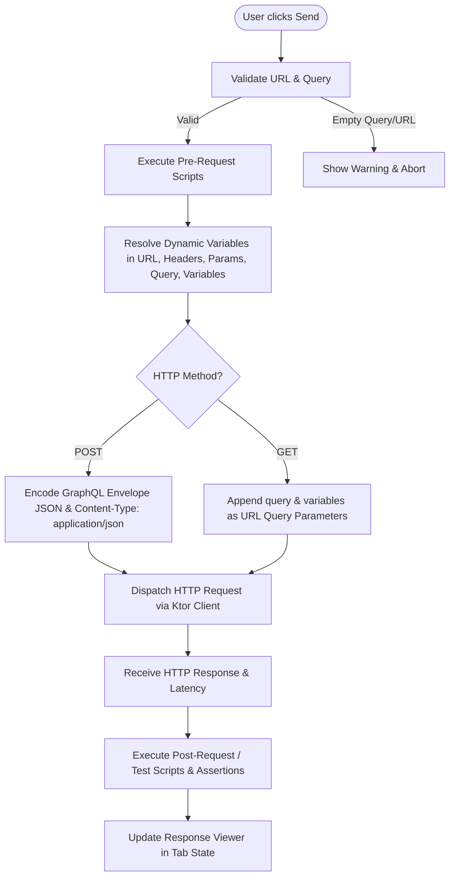

# Contract: GraphQL Execution & Network Transport

**Feature**: `014-graphql-requests`  
**Date**: 2026-11-10  

## 1. Execution Pipeline Overview

When the user initiates execution ("Send" action or hotkey) on a `RequestTabState` with `kind == RequestKind.GRAPHQL`:



---

## 2. Payload Construction Rules

### POST Execution (Default)
1. **Headers**:
   - Resolved request headers from `tab.headers` (only enabled items).
   - If no `Content-Type` header is explicitly provided by the user, inject `Content-Type: application/json`.
   - Injected authentication headers from `tab.auth*` (Bearer token, Basic auth, API key).
2. **Body**:
   - Evaluated via `encodeGraphQlEnvelope`:
     ```json
     {
       "query": "<resolved GraphQL query string>",
       "variables": <parsed or strict JSON variables object>
     }
     ```
   - JSON5 comments and unquoted keys in `variables` are normalized to strict JSON.

### GET Execution
1. The GraphQL query string is URL-encoded and appended as `?query=<encoded-query>`.
2. If variables are non-blank, they are JSON-encoded, URL-encoded, and appended as `&variables=<encoded-variables>`.
3. Sent with HTTP method `GET` and configured request headers.

---

## 3. Response Processing & Error Handling
1. Response body is parsed as JSON and displayed in the JSON Response Viewer with syntax highlighting.
2. If the response contains a top-level `"errors"` array (standard GraphQL error specification), the UI flags the response with a noticeable GraphQL error badge while preserving the raw response structure.
3. Network connection errors, DNS lookup failures, or SSL handshake timeouts are captured and displayed in `tab.lastError`.
