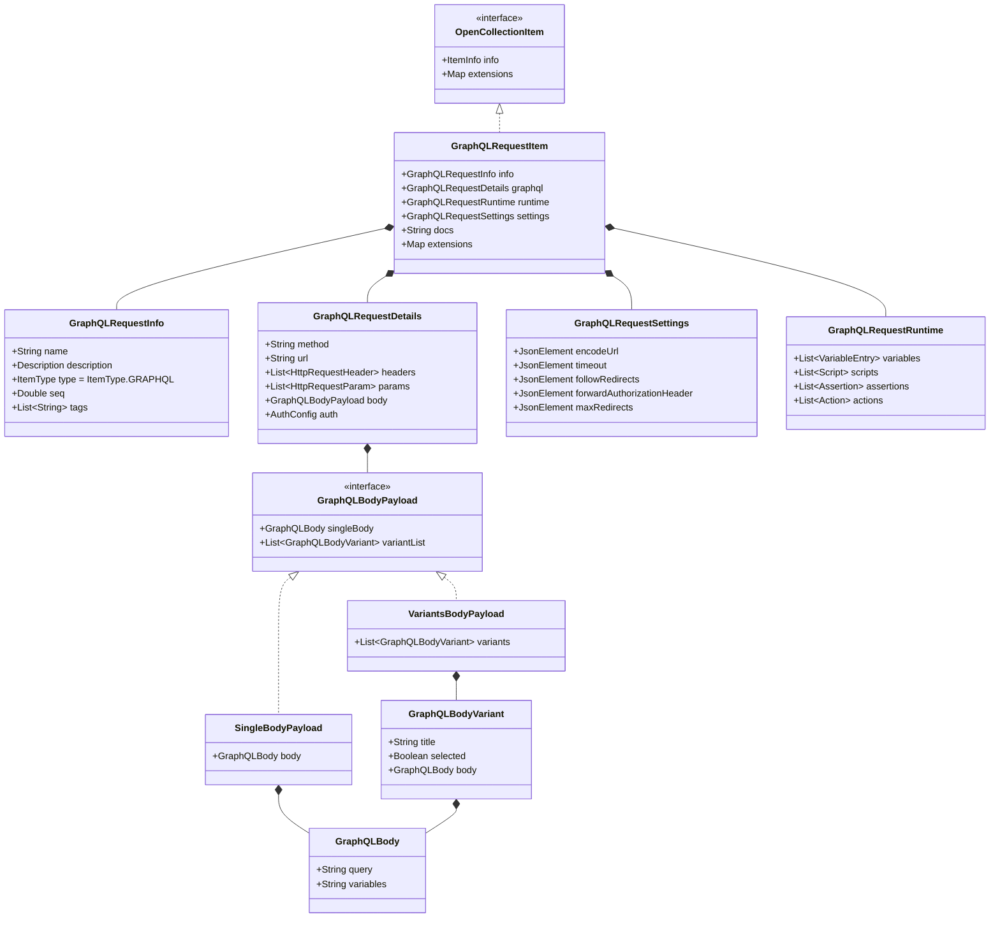

# Data Model: GraphQL Requests

**Feature**: `014-graphql-requests`  
**Date**: 2026-11-10  

## 1. OpenCollection Schema Domain Models (`core-model`)



### Kotlin Data Classes (`io.github.crustack.clapi.core.model.opencollection`)

```kotlin
@Serializable
data class GraphQLRequestInfo(
    override val name: String,
    override val description: Description? = null,
    override val type: ItemType = ItemType.GRAPHQL,
    override val seq: Double? = null,
    override val tags: List<String> = emptyList(),
) : ItemInfo

@Serializable
data class GraphQLBody(
    val query: String = "",
    val variables: String? = null,
)

@Serializable
data class GraphQLBodyVariant(
    val title: String,
    val selected: Boolean? = null,
    val body: GraphQLBody,
)

@Serializable(with = GraphQLBodyPayloadSerializer::class)
sealed interface GraphQLBodyPayload {
    val singleBody: GraphQLBody?
    val variantList: List<GraphQLBodyVariant>

    @Serializable
    data class Single(val body: GraphQLBody) : GraphQLBodyPayload

    @Serializable
    data class Variants(val variants: List<GraphQLBodyVariant>) : GraphQLBodyPayload
}

@Serializable
data class GraphQLRequestDetails(
    val method: String? = "POST",
    val url: String,
    val headers: List<HttpRequestHeader> = emptyList(),
    val params: List<HttpRequestParam> = emptyList(),
    val body: GraphQLBodyPayload? = null,
    val auth: AuthConfig? = null,
)

@Serializable
data class GraphQLRequestSettings(
    val encodeUrl: JsonElement? = null,
    val timeout: JsonElement? = null,
    val followRedirects: JsonElement? = null,
    val forwardAuthorizationHeader: JsonElement? = null,
    val maxRedirects: JsonElement? = null,
)

@Serializable
data class GraphQLRequestRuntime(
    val variables: List<VariableEntry> = emptyList(),
    val scripts: List<Script> = emptyList(),
    val assertions: List<Assertion> = emptyList(),
    val actions: List<Action> = emptyList(),
)

@Serializable
data class GraphQLRequestItem(
    override val info: GraphQLRequestInfo,
    val graphql: GraphQLRequestDetails,
    val runtime: GraphQLRequestRuntime? = null,
    val settings: GraphQLRequestSettings? = null,
    val docs: String? = null,
    @Transient override val extensions: Map<String, JsonElement> = emptyMap(),
) : OpenCollectionItem
```

---

## 2. In-Memory Editor State Models (`ui-shared`)

### `RequestKind` Extension
```kotlin
enum class RequestKind {
    HTTP,
    MCP,
    FOLDER,
    GRPC,
    COLLECTION,
    WEBSOCKET,
    GRAPHQL, // New first-class request kind
}
```

### `RequestTabState` Additions
```kotlin
class RequestTabState {
    // Shared state
    var kind: RequestKind = RequestKind.HTTP
    var url: String by mutableStateOf("")
    var name: String by mutableStateOf("New Request")
    
    // GraphQL specific state
    var graphQlMethod: String by mutableStateOf("POST")
    var graphQlQuery: String by mutableStateOf("")
    var graphQlVariables: String by mutableStateOf("")
    var graphQlVariants: List<GraphQLBodyVariant> by mutableStateOf(emptyList())
    var graphQlActiveVariantIndex: Int by mutableStateOf(0)
    var graphQlSettings: GraphQLRequestSettings? by mutableStateOf(null)
    var graphQlDocs: String? by mutableStateOf(null)
}
```

### `CollectionNode` Mapping
```kotlin
data class CollectionNode(
    val id: String,
    val name: String,
    val isFolder: Boolean,
    val url: String?,
    val method: HttpMethodType?,
    val kind: RequestKind = RequestKind.HTTP,
    
    // GraphQL specific fields
    val graphQlVariants: List<GraphQLBodyVariant> = emptyList(),
    val graphQlSettings: GraphQLRequestSettings? = null,
    val graphQlDocs: String? = null,
    // ...
)
```

---

## 3. Storage & Serialization Mapping

| OpenCollection v1.0.0 JSON Property | Clapi Domain Model | UI / Tab State |
|---|---|---|
| `info.type = "graphql"` | `ItemType.GRAPHQL` | `RequestKind.GRAPHQL` |
| `info.name` | `GraphQLRequestInfo.name` | `tab.name` |
| `graphql.method` | `GraphQLRequestDetails.method` | `tab.graphQlMethod` (POST / GET) |
| `graphql.url` | `GraphQLRequestDetails.url` | `tab.url` |
| `graphql.headers` | `GraphQLRequestDetails.headers` | `tab.headers` |
| `graphql.params` | `GraphQLRequestDetails.params` | `tab.params` |
| `graphql.body` (object) | `GraphQLBodyPayload.Single` | `tab.graphQlQuery`, `tab.graphQlVariables` |
| `graphql.body` (array) | `GraphQLBodyPayload.Variants` | `tab.graphQlVariants` |
| `graphql.auth` | `GraphQLRequestDetails.auth` | `tab.auth*` |
| `runtime.scripts` | `GraphQLRequestRuntime.scripts` | `tab.preRequestScript`, `tab.testScript` |
| `settings` | `GraphQLRequestSettings` | `tab.graphQlSettings` |
| `docs` | `GraphQLRequestItem.docs` | `tab.graphQlDocs` |
