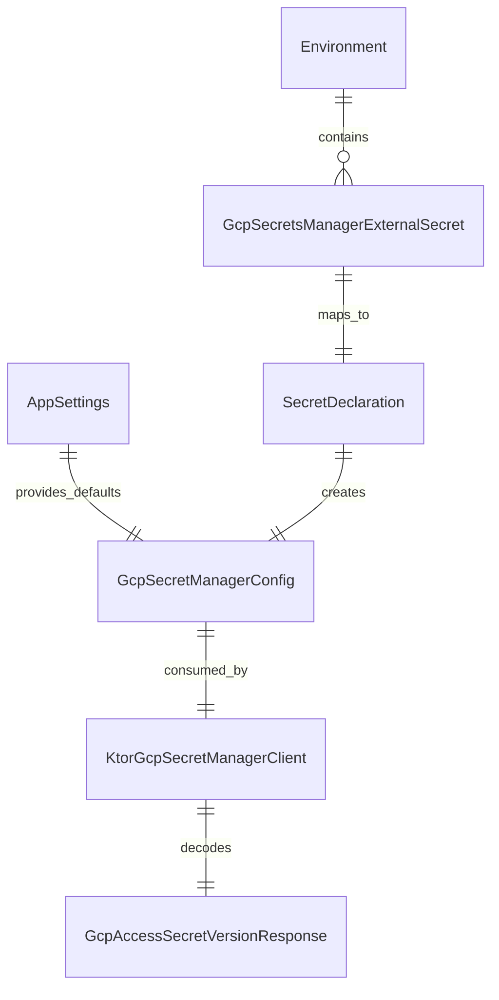

# Data Model: GCP Secret Manager Integration

## Overview

This document specifies the data models, entity relationships, validation rules, and state mappings for GCP Secret Manager support across `core-model`, `core-network`, `ui-shared`, and `core-storage`.

---

## 1. Core Model Entities (`core-model`)

### `GcpSecretsManagerExternalSecret`

Represents an individual external secret declaration in an environment backed by GCP Secret Manager.

```kotlin
package io.github.makeforge.clapi.core.model.opencollection

import kotlinx.serialization.Serializable

@Serializable
data class GcpSecretsManagerExternalSecret(
    override val name: String,
    val secretId: String,
    val version: String = "latest",
    val targetField: String = "",
    val projectId: String = "",
    val customFilters: Map<String, String> = emptyMap(),
    override val description: Description? = null,
    override val disabled: Boolean? = null,
) : ExternalSecretVariable
```

#### Fields & Constraints:
- `name`: Local placeholder reference name (e.g. `client_secret` resolving from `{{_secret.client_secret}}`). Must not be blank.
- `secretId`: The resource ID of the secret within GCP Secret Manager (e.g., `payment-foo`, `plain-token`). Must not be blank.
- `version`: Target version snapshot (e.g., `"1"`, `"2"`) or alias (e.g., `"staging"`), defaulting to `"latest"`.
- `targetField`: Specific key to extract if the secret payload is a JSON object. If blank, defaults to the whole secret value (or single key).
- `projectId`: Optional override for the Google Cloud project ID. If omitted or blank, falls back to the global Project ID configured in Settings.
- `customFilters`: Map of key-value attributes to match against parsed JSON payload, supporting variable interpolation (e.g., `stage -> {{env}}`).
- `description`: Optional user documentation.
- `disabled`: Flag indicating whether the secret is active (`false`/`null`) or inactive (`true`).

### Polymorphic Deserializer Registration

In `ExternalSecretVariableSerializer`:

```kotlin
object ExternalSecretVariableSerializer :
    JsonContentPolymorphicSerializer<ExternalSecretVariable>(ExternalSecretVariable::class) {
    override fun selectDeserializer(element: JsonElement): DeserializationStrategy<ExternalSecretVariable> {
        val obj = element.jsonObject
        return when {
            obj["type"]?.jsonPrimitive?.contentOrNull == "gcp-secrets-manager" ||
                (obj.containsKey("secretId") && !obj.containsKey("secretName") && !obj.containsKey("vaultName")) ->
                GcpSecretsManagerExternalSecret.serializer()
            obj.containsKey("vaultName") || obj["type"]?.jsonPrimitive?.contentOrNull == "azure-key-vault" ->
                AzureKeyVaultExternalSecret.serializer()
            obj.containsKey("secretName") || obj.containsKey("secretId") ->
                AwsSecretsManagerExternalSecret.serializer()
            obj.containsKey("url") || (obj.containsKey("targetField") && !obj.containsKey("path")) ->
                KeePassXcExternalSecret.serializer()
            else -> HashicorpVaultExternalSecret.serializer()
        }
    }
}
```

---

## 2. Network Client Configuration (`core-network`)

### `GcpSecretManagerConfig`

Encapsulates all connection, authentication, and secret identification parameters needed to retrieve a secret from GCP Secret Manager via REST.

```kotlin
package io.github.makeforge.clapi.core.network.gcp

data class GcpSecretManagerConfig(
    val projectId: String,
    val secretId: String,
    val version: String = "latest",
    val propertyKey: String? = null,
    val accessToken: String,
    val endpointUrl: String = "https://secretmanager.googleapis.com",
)
```

#### Fields & Constraints:
- `projectId`: GCP project ID or number (e.g., `my-cloud-project`).
- `secretId`: Secret resource identifier.
- `version`: Target version snapshot or alias, defaulting to `"latest"`.
- `propertyKey`: Optional target field to isolate from a JSON payload.
- `accessToken`: Google OAuth2 access token or service account bearer token.
- `endpointUrl`: Base URL for the GCP Secret Manager service, normalizing trailing slashes.

### Payload Response Models

```kotlin
package io.github.makeforge.clapi.core.network.gcp

import kotlinx.serialization.Serializable

@Serializable
internal data class GcpSecretPayload(
    val data: String? = null
)

@Serializable
internal data class GcpAccessSecretVersionResponse(
    val name: String? = null,
    val payload: GcpSecretPayload? = null
)
```

---

## 3. Runtime Resolution Model (`core-network`)

### `SecretDeclaration`

The internal domain representation mapped from environment external secrets across all providers:

```kotlin
data class SecretDeclaration(
    val name: String,
    val path: String = "",
    val enabled: Boolean = true,
    val providerType: String = "hashicorp-vault-server",
    val url: String = "",
    val targetField: String = "password",
    val customFilters: Map<String, String> = emptyMap(),
    val secretId: String = path,
    val version: String = "latest",
    val projectId: String = "",
)
```

---

## 4. UI & Preferences State (`ui-shared`)

### `AppSettings` GCP Properties

Added to `AppSettings` to persist connection defaults:

```kotlin
// Secrets Manager (GCP)
var gcpProjectId    by mutableStateOf("")
var gcpAccessToken  by mutableStateOf("")
var gcpEndpointUrl  by mutableStateOf("https://secretmanager.googleapis.com")
```

### Storage Persistence Keys:
- `clapi.gcpProjectId` -> `PlatformStorage.getString` / `putString`
- `clapi.gcpAccessToken` -> `PlatformStorage.getSecretString` / `putSecretString` (Encrypted)
- `clapi.gcpEndpointUrl` -> `PlatformStorage.getString` / `putString`

### `MutableExternalSecret`

The UI state representation in `EnvironmentModels.kt`:
- `name`: Variable reference name
- `path`: Maps to `secretId`
- `url`: Maps to `projectId` (override)
- `targetField`: Property key to extract
- `version`: Target version snapshot (defaults to `"latest"`)
- `customFilters`: Custom filter map
- `description`: Explanatory text
- `enabled`: Toggle for activation

---

## 5. Entity Relationships


