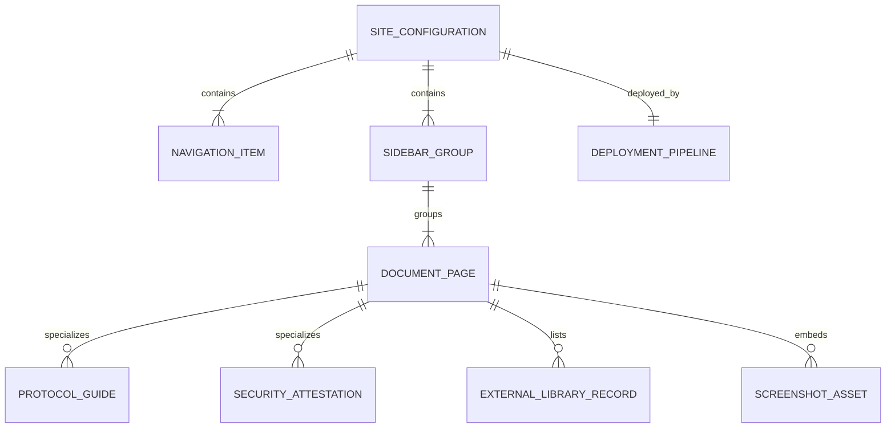

# Data Model & Information Architecture: VitePress Documentation Site

**Feature**: `024-vitepress-documentation`
**Date**: 2026-11-14
**Status**: Completed

This document models the conceptual and structural entities comprising Clapi's documentation site, their attributes, relationships, and validation constraints.

---

## 1. Entity Relationship Diagram

---

## 2. Entity Definitions

### 2.1 SiteConfiguration
Represents the global VitePress site settings configured in `.vitepress/config.mts`.

| Attribute | Type | Description | Validation / Constraints |
|---|---|---|---|
| `title` | String | Documentation site title | Non-empty, default: `"Clapi Documentation"` |
| `description` | String | Meta description for SEO | Non-empty |
| `base` | String | Base public path for GitHub Pages | Defaults to `"/Clapi/"` or `"/"` |
| `cleanUrls` | Boolean | URL routing format | Must be `true` (e.g. `/guide/quickstart` instead of `.html`) |
| `themeConfig` | Object | Visual branding, nav, sidebar, search | Required |
| `search` | Object | Local search configuration | Must specify `provider: 'local'` with `minisearch` |

---

### 2.2 NavigationItem & SidebarGroup
Represents top-level navigation and collapsible sidebar hierarchies.

#### NavigationItem
| Attribute | Type | Description |
|---|---|---|
| `text` | String | Display label in header |
| `link` | String (optional) | Destination path (if direct link) |
| `items` | Array<NavigationItem> (optional) | Sub-items (if dropdown menu) |
| `activeMatch` | String (optional) | Regex pattern to highlight active tab |

#### SidebarGroup
| Attribute | Type | Description |
|---|---|---|
| `text` | String | Sidebar section heading |
| `collapsed` | Boolean | Whether group is collapsible / default collapsed state |
| `items` | Array<SidebarItem> | Ordered list of pages or sub-groups |

---

### 2.3 DocumentPage
Represents an individual Markdown (`.md`) file published on the site.

| Attribute | Type | Description | Validation / Constraints |
|---|---|---|---|
| `filePath` | String | Path relative to `docs/` | Must end with `.md` |
| `route` | String | Canonical URL path | Lowercase, kebab-case |
| `title` | String | Page title in frontmatter and H1 | Required |
| `description` | String | Page summary in frontmatter | Required, 50-160 chars |
| `content` | Markdown | Document body | Must follow Universal Page Structure |
| `badges` | Array<String> | Status or protocol badges | Optional (e.g. `Protocol: HTTP`, `v1.20+`) |
| `relatedLinks` | Array<String> | Cross-references at page bottom | Recommended |

---

### 2.4 ProtocolGuide (Specialized DocumentPage)
Represents a parent page and associated subpages documenting a supported request protocol.

| Attribute | Type | Description | Validation / Constraints |
|---|---|---|---|
| `protocolId` | Enum | `HTTP`, `GRAPHQL`, `WEBSOCKET`, `GRPC`, `MCP`, `REALTIME` | Required |
| `parentRoute` | String | Parent overview route | e.g. `/request-types/http/` |
| `screenshot` | ScreenshotAsset | Visual UI screenshot displayed on parent page | Mandatory on parent page |
| `subpages` | Array<DocumentPage> | Deep-dive feature subpages | Minimum 3 subpages per protocol |
| `quickstartSteps` | Array<String> | Actionable steps to execute a request | 3-5 steps |

---

### 2.5 SecurityAttestation (Specialized DocumentPage)
Represents documentation covering privacy, cryptography, and supply chain security.

| Attribute | Type | Description | Key Topics |
|---|---|---|---|
| `attestationType` | Enum | `ZERO_TELEMETRY`, `KSAFE_ENCRYPTION`, `SBOM_OSV_AUDIT` | Required |
| `verificationMethod` | String | How users can independently verify the claim | Network inspection, code review, SARIF logs |
| `cryptographicStandard` | String | Encryption specs (if applicable) | AES-256-GCM, PBKDF2 |
| `complianceStandards` | Array<String> | Applicable compliance standards | Air-gapped readiness, CycloneDX v1.5 |

---

### 2.6 ExternalLibraryRecord
Represents an entry in the transparent open-source library directory (`/security/external-libraries.md`).

| Attribute | Type | Description | Example |
|---|---|---|---|
| `name` | String | Common library name | `"KSafe"` |
| `coordinates` | String | Maven / Gradle dependency coordinates | `"eu.anifantakis:ksafe"` |
| `version` | String | Version pinned in catalog | `"3.3.0"` |
| `license` | String | Open-source license | `"Apache-2.0"` |
| `githubUrl` | URL | Link to official upstream GitHub repo | `"https://github.com/ioannisa/ksafe"` |
| `purpose` | String | Role and functionality in Clapi | `"Local encrypted credential and secret storage"` |

---

### 2.7 ScreenshotAsset
Represents an image asset embedded in documentation.

| Attribute | Type | Description | Constraints |
|---|---|---|---|
| `fileName` | String | File name in `docs/public/screenshots/` | e.g. `clapi-screenshot.png` |
| `format` | Enum | `PNG`, `SVG` | Optimized, high resolution |
| `themeVariant` | Enum | `DARK`, `LIGHT`, `NEUTRAL` | Matches Clapi UI themes |
| `altText` | String | Accessible description | Required |
| `caption` | String | Descriptive figure caption | Recommended |

---

### 2.8 DeploymentPipeline
Represents the CI/CD deployment configuration in `.github/workflows/deploy-docs.yml`.

| Attribute | Type | Description | Value |
|---|---|---|---|
| `triggerPaths` | Array<String> | Monitored file changes | `['docs/**', '.github/workflows/deploy-docs.yml']` |
| `targetBranch` | String | Production branch | `'main'` |
| `nodeVersion` | String | Runtime environment | `'22'` |
| `buildOutputDirectory` | String | Artifact directory | `'docs/.vitepress/dist'` |
| `targetEnvironment` | String | GitHub Pages deployment environment | `'github-pages'` |
