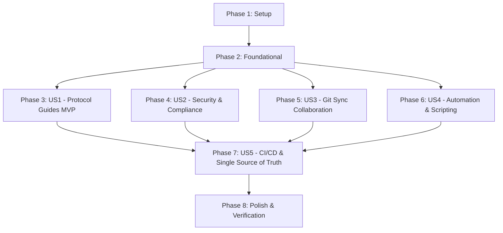

# Tasks: Production VitePress Documentation Site

**Input**: Design documents from `specs/024-vitepress-documentation/`
**Prerequisites**: [plan.md](./plan.md) (required), [spec.md](./spec.md) (required), [research.md](./research.md), [data-model.md](./data-model.md), [contracts/](./contracts/), [quickstart.md](./quickstart.md)

**Tests**: Build-time link validation and quickstart scenario verification are included to validate the documentation site end-to-end.

**Organization**: Tasks are grouped by user story to enable independent implementation and testing of each story.

## Format: `- [ ] [TaskID] [P?] [Story?] Description with file path`

- **[P]**: Can run in parallel (different files, no dependencies)
- **[Story]**: Which user story this task belongs to (`[US1]`, `[US2]`, `[US3]`, `[US4]`, `[US5]`)
- Include exact file paths in all descriptions

---

## Phase 1: Setup (Shared Infrastructure)

**Purpose**: Project initialization and basic VitePress structure under `docs/`

- [X] T001 Initialize npm package and VitePress dependencies in `docs/package.json`
- [X] T002 [P] Create initial VitePress configuration file with local search and base URL in `docs/.vitepress/config.mts`
- [X] T003 [P] Create Material 3 visual theme and token stylesheet in `docs/.vitepress/theme/custom.css`
- [X] T004 [P] Configure custom theme entry point and layout hooks in `docs/.vitepress/theme/index.ts`
- [X] T005 [P] Centralize public static branding assets and app icons in `docs/public/logo.svg` and `docs/public/favicon.ico`

---

## Phase 2: Foundational (Blocking Prerequisites)

**Purpose**: Core infrastructure and layout that MUST be complete before ANY user story can be implemented

⚠️ **CRITICAL**: No user story content writing can begin until this phase is complete

- [X] T006 [P] Create centralized screenshots directory structure in `docs/public/screenshots/` and copy existing screenshots (`clapi-screenshot.png`, `clapi-screenshot-light.png`, `mcp-tools.png`)
- [X] T007 [P] Configure Shiki syntax highlighting grammars (Kotlin, Proto, GraphQL, HTTP, JSON5) in `docs/.vitepress/config.mts`
- [X] T008 [P] Configure Top Navigation bar hierarchy in `docs/.vitepress/config.mts`
- [X] T009 [P] Configure Collapsible Sidebar multi-group hierarchy in `docs/.vitepress/config.mts`
- [X] T010 Implement Documentation Landing / Hero Page with quick-links and feature highlights in `docs/index.md`

**Checkpoint**: Foundation ready — user story implementation can now begin in parallel

---

## Phase 3: User Story 1 - Multi-Protocol API Guidance (Priority: P1) 🎯 MVP

**Goal**: Deliver complete, visually rich guides with parent UI screenshots and deep-dive subpages for all supported request protocols (HTTP/REST, GraphQL, WebSocket, gRPC, MCP, Realtime)

**Independent Test**: Navigate to each protocol overview page, confirm parent UI screenshot renders, and verify all subpages explain parameters, authentication, body payloads, and response inspection.

### Implementation for User Story 1

- [X] T011 [P] [US1] Author Getting Started and Installation guide in `docs/guide/installation.md`
- [X] T012 [P] [US1] Author 60-Second Quickstart guide in `docs/guide/quickstart.md`
- [X] T013 [P] [US1] Author Core Concepts and UI Anatomy guide in `docs/guide/core-concepts.md`
- [X] T014 [US1] Author HTTP / REST parent overview page with hero UI screenshot in `docs/request-types/http/index.md`
- [X] T015 [P] [US1] Author HTTP URL Parameters and Matrix Params guide in `docs/request-types/http/parameters.md`
- [X] T016 [P] [US1] Author HTTP Headers and Cascaded Inheritance guide in `docs/request-types/http/headers.md`
- [X] T017 [P] [US1] Author HTTP Request Body Formats (JSON5, Multipart, Form-urlencoded, Raw, Binary) guide in `docs/request-types/http/body.md`
- [X] T018 [P] [US1] Author HTTP Authentication Methods (Basic, Bearer, API Key, OAuth 2.0 PKCE, AWS SigV4) in `docs/request-types/http/authentication.md`
- [X] T019 [P] [US1] Author HTTP Response Viewer & Performance Metrics Breakdown guide in `docs/request-types/http/response-viewer.md`
- [X] T020 [P] [US1] Author cURL Import & Export integration guide in `docs/request-types/http/curl.md`
- [X] T021 [US1] Author GraphQL parent overview page with UI screenshot in `docs/request-types/graphql/index.md`
- [X] T022 [P] [US1] Author GraphQL Query & Mutation Editor guide in `docs/request-types/graphql/queries.md`
- [X] T023 [P] [US1] Author GraphQL Query Variables guide in `docs/request-types/graphql/variables.md`
- [X] T024 [P] [US1] Author GraphQL Schema Introspection & Docs Explorer guide in `docs/request-types/graphql/introspection.md`
- [X] T025 [P] [US1] Author GraphQL Authentication & Custom Headers guide in `docs/request-types/graphql/auth.md`
- [X] T026 [US1] Author WebSocket parent overview page with UI screenshot in `docs/request-types/websocket/index.md`
- [X] T027 [P] [US1] Author WebSocket Handshake and Connection Management guide in `docs/request-types/websocket/connection.md`
- [X] T028 [P] [US1] Author WebSocket Real-time Message Composer guide in `docs/request-types/websocket/composer.md`
- [X] T029 [P] [US1] Author WebSocket Live Message Log & Stream Filtering guide in `docs/request-types/websocket/message-log.md`
- [X] T030 [P] [US1] Author WebSocket Connection Lifecycle & Heartbeats guide in `docs/request-types/websocket/lifecycle.md`
- [X] T031 [US1] Author gRPC parent overview page with UI screenshot in `docs/request-types/grpc/index.md`
- [X] T032 [P] [US1] Author gRPC Protobuf Schema Management & Directory Roots guide in `docs/request-types/grpc/proto-management.md`
- [X] T033 [P] [US1] Author gRPC Server Reflection guide in `docs/request-types/grpc/reflection.md`
- [X] T034 [P] [US1] Author gRPC Method Selection & RPC Invocation guide in `docs/request-types/grpc/method-invocation.md`
- [X] T035 [P] [US1] Author gRPC JSON-to-Protobuf Message Composer guide in `docs/request-types/grpc/message-composer.md`
- [X] T036 [P] [US1] Author gRPC Metadata & Custom Headers guide in `docs/request-types/grpc/metadata.md`
- [X] T037 [P] [US1] Author gRPC TLS & Client Certificate (mTLS) configuration guide in `docs/request-types/grpc/tls.md`
- [X] T038 [US1] Author Model Context Protocol (MCP) parent overview page with screenshot in `docs/request-types/mcp/index.md`
- [X] T039 [P] [US1] Author MCP Transports (Streamable HTTP, Legacy SSE, Stdio with Shell PATH) guide in `docs/request-types/mcp/transports.md`
- [X] T040 [P] [US1] Author MCP Tools Discovery, Schema Validation & Execution guide in `docs/request-types/mcp/tools.md`
- [X] T041 [P] [US1] Author MCP Resources & Real-time Subscriptions guide in `docs/request-types/mcp/resources.md`
- [X] T042 [P] [US1] Author MCP Prompts & LLM Sampling guide in `docs/request-types/mcp/prompts.md`
- [X] T043 [P] [US1] Author MCP OAuth 2.1 & Dynamic Client Registration guide in `docs/request-types/mcp/auth.md`
- [X] T044 [P] [US1] Author MCP Activity Log & JSON-RPC Protocol Inspector guide in `docs/request-types/mcp/activity-log.md`
- [X] T045 [US1] Author Realtime Streams guide (SSE, Socket.IO, MQTT) in `docs/request-types/realtime/index.md`

**Checkpoint**: At this point, User Story 1 is fully functional and delivers complete multi-protocol guidance (MVP)

---

## Phase 4: User Story 2 - Security, Privacy & Enterprise Compliance Verification (Priority: P1)

**Goal**: Deliver prominent documentation on Clapi's zero-telemetry policy, KSafe local credential encryption, CycloneDX SBOM generation, OSV vulnerability scanning, and transparent open-source libraries catalog with upstream GitHub links

**Independent Test**: Navigate to the Security & Trust section, verify zero-telemetry assertions, review KSafe cryptographic details, inspect SBOM/OSV scan workflow documentation, and verify that all external library links point to active GitHub repositories.

### Implementation for User Story 2

- [X] T046 [US2] Author Zero-Telemetry & Air-Gap Privacy Policy with packet inspection verification guide in `docs/security/zero-telemetry.md`
- [X] T047 [US2] Author Local Credential Encryption architecture guide detailing KSafe AES-256-GCM and PBKDF2 in `docs/security/ksafe-encryption.md`
- [X] T048 [US2] Author CycloneDX SBOM generation, OSV-Scanner checks, and GitHub Security SARIF reporting guide in `docs/security/sbom-vulnerabilities.md`
- [X] T049 [US2] Author Comprehensive External Libraries Directory listing all runtime dependencies with active GitHub links and licenses in `docs/security/external-libraries.md`

**Checkpoint**: User Stories 1 and 2 are complete, establishing both functional protocol mastery and enterprise trust

---

## Phase 5: User Story 3 - Team Collaboration via Git Sync & OpenCollection (Priority: P2)

**Goal**: Document how engineering teams collaborate on API collections using Git repositories, the in-app Git Sync dialog, branch management, merge conflict resolution, and Protobuf schema versioning

**Independent Test**: Follow the Git Sync guide to configure a local collection, review status indicators, stage/commit changes, and synchronize collection files and `.proto` schemas across branches.

### Implementation for User Story 3

- [X] T050 [US3] Author Multiple Collections & OpenCollection Architecture guide in `docs/workspaces/collections.md`
- [X] T051 [US3] Author Folder Settings & Cascaded Request Defaults Inheritance guide in `docs/workspaces/folders-and-inheritance.md`
- [X] T052 [P] [US3] Author Collection-Level Protobuf Settings guide in `docs/workspaces/protobuf-settings.md`
- [X] T053 [US3] Author Git Sync Architecture and OpenCollection Git-native diffing guide in `docs/collaboration/git-sync-overview.md`
- [X] T054 [US3] Author In-App Git Operations (GitSyncDialog, status indicator, branch, commit, push, pull) guide in `docs/collaboration/git-operations.md`
- [X] T055 [P] [US3] Author Team Workflows, Pull Requests, and Conflict Resolution guide in `docs/collaboration/team-workflows.md`

**Checkpoint**: Team collaboration workflows and OpenCollection architecture are fully documented

---

## Phase 6: User Story 4 - Advanced Automation, Environments & Scripting Reference (Priority: P2)

**Goal**: Document variable scoping hierarchy, cloud secret manager integrations, and the embedded Javet V8 JavaScript scripting engine with complete `clapi.*` assertion API reference

**Independent Test**: Consult the Scripting API reference to verify all assertion methods, chained operators, and dynamic variables are documented with executable code examples.

### Implementation for User Story 4

- [X] T056 [US4] Author Variable Scopes, Interpolation Syntax & Dynamic Variables guide in `docs/environments/variables.md`
- [X] T057 [P] [US4] Author Environments & Fast Switching guide in `docs/environments/environments.md`
- [X] T058 [US4] Author External Secret Managers guide (KeePassXC, AWS Secrets Manager, Azure Key Vault, GCP, Keeper) with KSafe encryption guarantees in `docs/environments/secret-managers.md`
- [X] T059 [US4] Author Javet V8 Embedded JavaScript Engine Architecture & Sandbox Security guide in `docs/scripting/engine-architecture.md`
- [X] T060 [P] [US4] Author Pre-Request Scripting Guide in `docs/scripting/pre-request.md`
- [X] T061 [P] [US4] Author Post-Response Testing & Assertions Guide in `docs/scripting/post-response-tests.md`
- [X] T062 [US4] Author Complete `clapi.*` Scripting API & Assertion Reference with Chai chaining examples in `docs/scripting/api-reference.md`

**Checkpoint**: Advanced scripting, environment hierarchies, and external secret vault integrations are fully documented

---

## Phase 7: User Story 5 - Continuous Deployment & Single Source of Truth (Priority: P3)

**Goal**: Automate static site generation and GitHub Pages publishing via GitHub Actions while deprecating legacy disconnected markdown files in `/docs`

**Independent Test**: Trigger a documentation build, verify zero broken internal links, and confirm deployment to GitHub Pages on pushes to `main`.

### Implementation for User Story 5

- [X] T063 [US5] Author Specification Import (OpenAPI v3+, OpenCollection, Postman, Insomnia) guide in `docs/import-export/import.md`
- [X] T064 [P] [US5] Author Workspace and Sanitized Collection Export guide in `docs/import-export/export.md`
- [X] T065 [P] [US5] Author Application Settings, Themes & Proxy/TLS Configuration guide in `docs/reference/settings.md`
- [X] T066 [P] [US5] Author Complete Keyboard Shortcuts Cheat Sheet (macOS, Windows, Linux) in `docs/reference/shortcuts.md`
- [X] T067 [P] [US5] Port Clapi Architectural Deep Dive and Module Map from legacy docs to `docs/reference/architecture.md`
- [X] T068 [P] [US5] Port Testing Strategy & Integration Test Reference from legacy docs to `docs/reference/testing.md`
- [X] T069 [US5] Implement Automated GitHub Pages Deployment CI/CD workflow in `.github/workflows/deploy-docs.yml`
- [X] T070 [US5] Remove legacy disconnected markdown documents in root `docs/` (`../../docs/old/mcp.md`, `../../docs/old/collections.md`, etc.) to establish new docs as single source of truth

**Checkpoint**: All historical knowledge is preserved in the new structure, legacy files are decommissioned, and automated deployment is active

---

## Phase 8: Polish & Cross-Cutting Concerns

**Purpose**: Quality verification, link auditing, search performance, and styling consistency

- [X] T071 Validate static site generation and zero broken internal links via `npm run docs:build` in `docs/`
- [X] T072 [P] Validate offline client-side search query responsiveness in `docs/`
- [X] T073 Validate responsive theme toggle (Dark / Light) styling across all components in `docs/`
- [X] T074 Execute end-to-end quickstart validation scenarios defined in `specs/024-vitepress-documentation/quickstart.md`

---

## Dependencies & Execution Order

### Phase Dependencies

- **Setup (Phase 1)**: Must run first to create npm and VitePress base files.
- **Foundational (Phase 2)**: Depends on Setup; sets up navigation, sidebar, screenshots, and Shiki grammars. Blocks all user stories.
- **User Story 1 & 2 (Phases 3 & 4)**: High priority (P1). Can run in parallel once Foundation is complete.
- **User Story 3 & 4 (Phases 5 & 6)**: Medium priority (P2). Can proceed concurrently.
- **User Story 5 (Phase 7)**: CI/CD automation and cleanup of legacy `/docs` markdown files after content is ported.
- **Polish (Phase 8)**: Final validation phase verifying zero broken links and local search speed.

---

## Parallel Opportunities

- **Setup Tasks**: T002, T003, T004, and T005 can run in parallel.
- **Foundational Tasks**: T006, T007, T008, and T009 can run in parallel.
- **Protocol Subpages**: In User Story 1, HTTP subpages (T015–T020), GraphQL subpages (T022–T025), WebSocket subpages (T027–T030), gRPC subpages (T032–T037), and MCP subpages (T039–T044) touch separate files and can all be authored in parallel.
- **Reference & Porting**: In User Story 5, settings (T065), shortcuts (T066), architecture (T067), and testing (T068) can be authored in parallel.

---

## Implementation Strategy

### MVP First (Phases 1, 2, and 3)
1. Complete Phase 1 (Setup) and Phase 2 (Foundational).
2. Author Phase 3 (User Story 1: Protocol Guides).
3. **Validate MVP**: Run `npm run docs:dev` locally and verify all protocol parent pages with screenshots and subpages.

### Incremental Delivery
1. Add Phase 4 (User Story 2: Zero Telemetry, KSafe, SBOM, External Libraries).
2. Add Phase 5 (User Story 3: Git Sync & OpenCollection).
3. Add Phase 6 (User Story 4: Scripting Reference & Cloud Secret Managers).
4. Add Phase 7 (User Story 5: CI/CD Deployment & Legacy `/docs` Cleanup).
5. Run Phase 8 (Polish & Verification) to ensure zero broken links.
