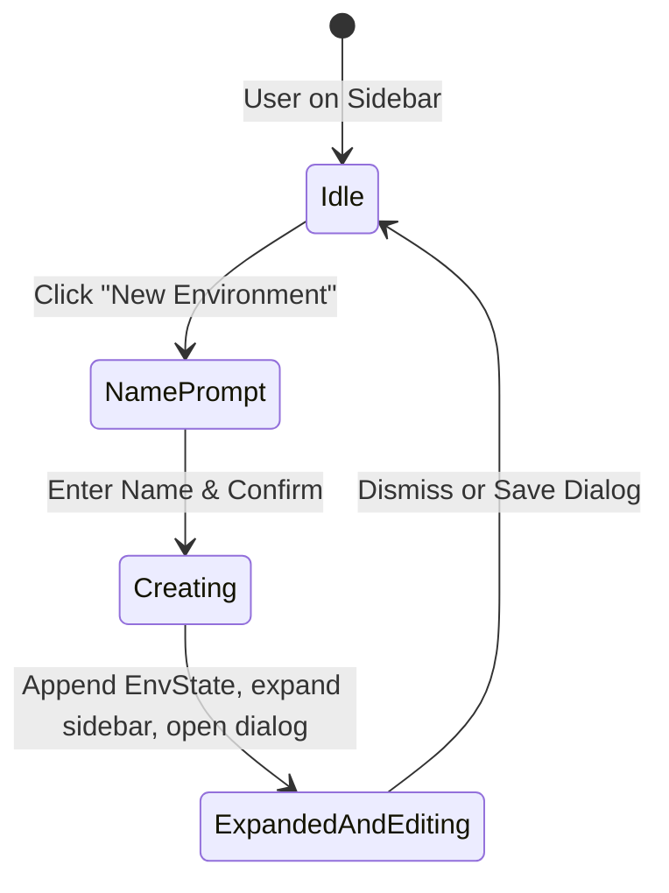
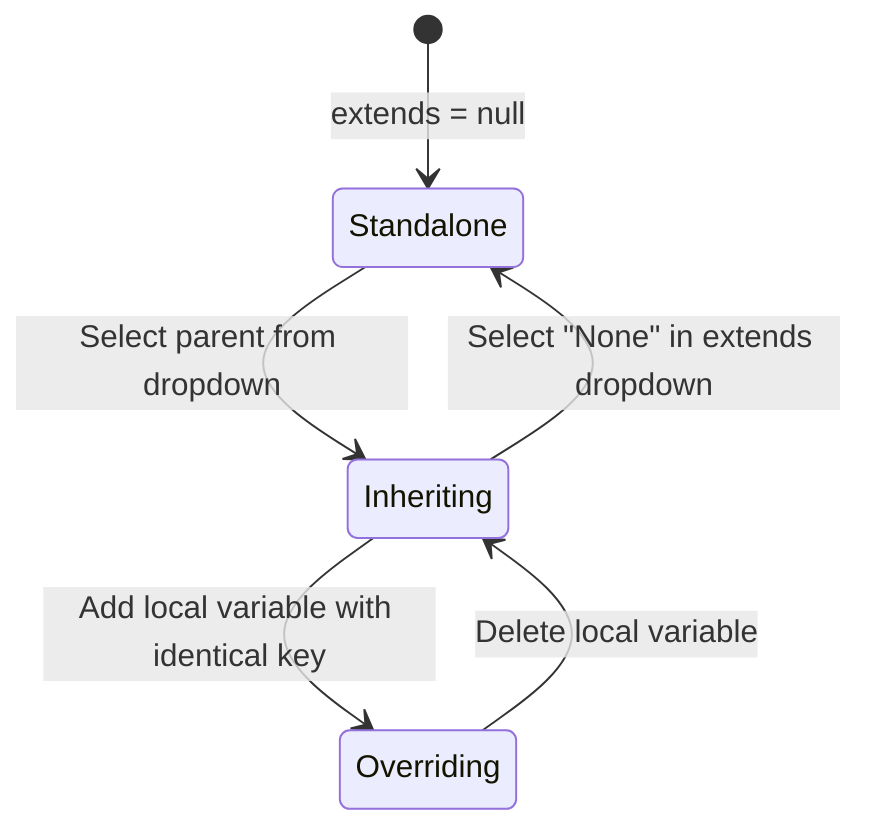
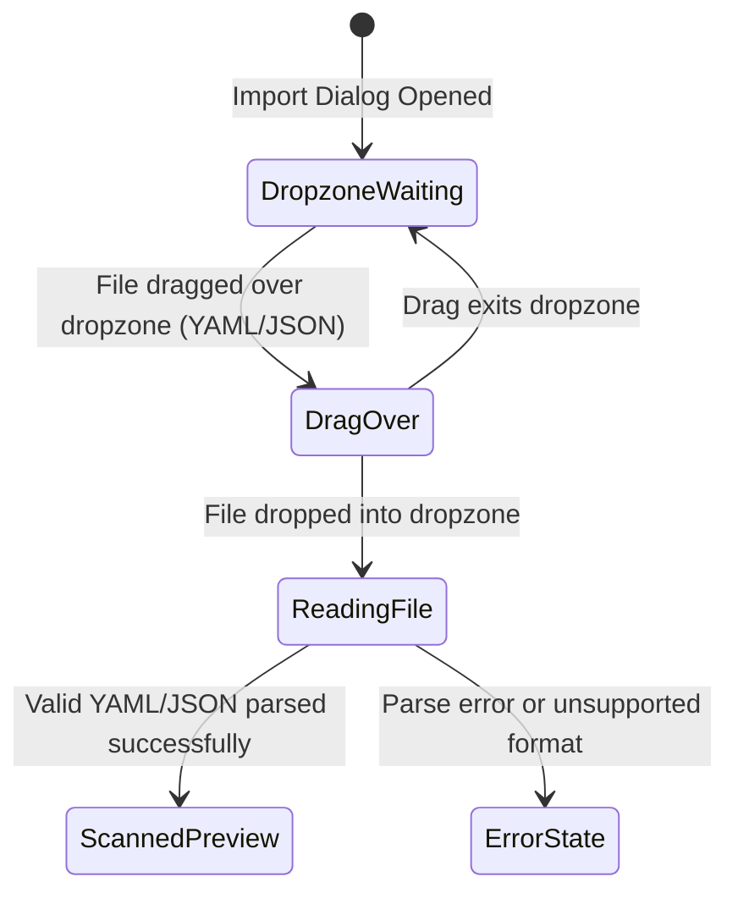

# Data Model: Environment Enhancements

## Entities & Attributes

### 1. `EnvState` (Runtime UI & Workspace State)
Represents the active in-memory state of an environment within `AppState`.

| Attribute | Type | Description |
|-----------|------|-------------|
| `name` | `String` (observable) | Name of the environment (unique within workspace). |
| `color` | `String?` (observable) | Hex color code (e.g., `"#3B82F6"`), optional. |
| `extends` | `String?` (observable) | Name of parent environment to inherit from, optional. |
| `variables` | `SnapshotStateList<MutableKeyValue>` | Locally defined key-value variables. |
| `externalSecretsProvider` | `String` (observable) | Identifier of external secrets provider (e.g. `"aws-secrets-manager"`). |
| `externalSecrets` | `SnapshotStateList<MutableExternalSecret>` | Configured external secret references. |
| `clientCertificates` | `List<ClientCertificate>` | Client TLS certificates. |
| `dotEnvFilePath` | `String?` | Path to optional `.env` file. |

### 2. `InheritedVariableInfo` (Computed Inheritance Projection)
Represents a resolved variable entry when inspecting or resolving variables for an environment that has an inheritance chain.

| Attribute | Type | Description |
|-----------|------|-------------|
| `key` | `String` | Variable name. |
| `value` | `String` | Effective resolved variable value. |
| `sourceEnvName` | `String` | Name of the environment where this value originated. |
| `isInherited` | `Boolean` | `true` if defined in an ancestor environment rather than locally. |
| `isOverridden` | `Boolean` | `true` if an ancestor defined this key but the child defined its own value. |
| `overriddenValue` | `String?` | Original ancestor value being overridden (for tooltip/audit). |

### 3. `EnvironmentColorPreset`
Predefined color swatches available in the color picker.

| Name | Hex Code | Purpose |
|------|----------|---------|
| Red | `#EF4444` | High-risk environments (e.g. Production). |
| Orange | `#F97316` | Staging / Pre-release environments. |
| Amber | `#F59E0B` | Testing / QA environments. |
| Green | `#10B981` | Safe local / Mock environments. |
| Cyan | `#06B6D4` | Development / Sandbox environments. |
| Blue | `#3B82F6` | Default / General environments. |
| Purple | `#8B5CF6` | Demo / Partner environments. |
| Gray | `#6B7280` | Archived / Baseline environments. |

### 4. `ClapiEnvironmentDto` & Export Payload
The serialized JSON structure used for individual environment import and export.

```json
{
  "type": "clapiEnvironment",
  "name": "Production",
  "color": "#EF4444",
  "extends": "Base",
  "variables": {
    "API_URL": "https://api.prod.example.com",
    "TIMEOUT": "60"
  },
  "externalSecrets": {
    "type": "aws-secrets-manager",
    "variables": [
      {
        "name": "DB_PASSWORD",
        "secretName": "prod/rds/credentials",
        "targetField": "password",
        "description": "Production database password",
        "disabled": false
      }
    ]
  }
}
```

*Security Invariant*: No resolved secret values or tokens appear in `variables` or `externalSecrets`. Variables with `secret = true` have empty/masked values or are omitted from plaintext export.

---

## State Transitions

### 1. New Environment Creation Flow


- **Trigger**: Click `sidebar-new-environment-button` or `top-toolbar-create-env`.
- **Pre-condition**: Environments section in sidebar may be collapsed or expanded.
- **Actions**:
  1. Append new `EnvState(uniqueName)`.
  2. Set `selectedEnvIndex = environments.lastIndex`.
  3. Set `environmentsExpanded = true` and `settings.environmentsExpanded = true`.
  4. Invoke `openEnvEdit(selectedEnvIndex)`.
- **Post-condition**: Sidebar shows expanded environments with new item highlighted, and `EnvironmentEditDialog` is displayed in foreground.

---

### 2. Environment Inheritance Setup & Override Flow


- **Cycle Validation Rule**:
  Let $E$ be the environment being edited. An environment $P$ is an eligible parent if and only if:
  1. $P \neq E$
  2. $E \notin \text{ancestors}(P)$
- **Resolution Traversal Rule**:
  $$\text{effectiveVars}(E) = \text{localVars}(E) \cup (\text{effectiveVars}(E.\text{extends}) \setminus \text{keys}(\text{localVars}(E)))$$
  Local variables strictly override ancestor variables with matching keys.

---

### 3. Quick-Add Inline Row State Transition
- **Initial State**: Quick-add row displays empty fields (`key = ""`, `value = ""`).
- **Input**: User types into quick-add fields.
- **Commit Trigger**: User presses `Enter` in key/value field or clicks `Add` icon.
- **Validation**: If `key.trim().isNotEmpty()`, append `MutableKeyValue` to `workingVars` and reset inputs to `""`. If blank, ignore without adding.

---

### 4. File Drop Import State Transition

