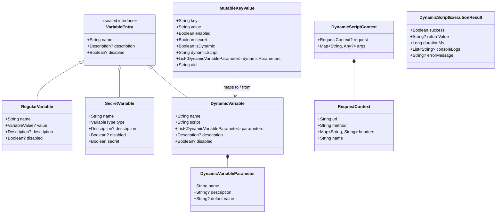
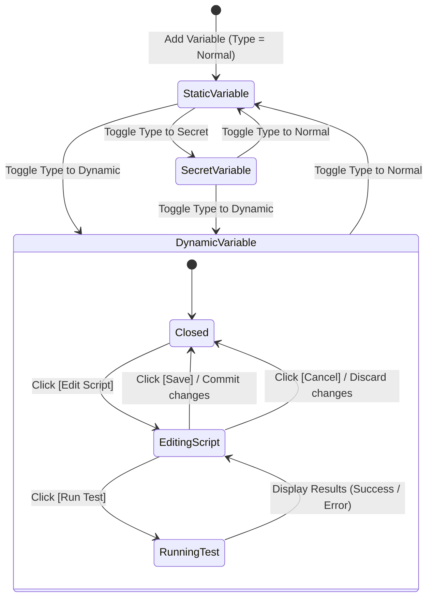

# Data Model: User-Defined Scriptable Dynamic Variables

**Branch**: `027-dynamic-variables` | **Date**: 2026-11-15 | **Spec**: [spec.md](spec.md)

## Entity Relationship Overview



---

## Entities Specification

### 1. `DynamicVariable` (implements `VariableEntry`)

Represents an executable dynamic variable entry persisted within an OpenCollection document (environment or collection level).

| Field | Type | Required | Description | Validation / Constraints |
|---|---|:---:|---|---|
| `name` | `String` | Yes | Variable token identifier (e.g., `secondsFromNow`, `hmacToken`). | Must be a valid identifier (alphanumeric, underscores, hyphens, non-empty, trimmed). |
| `script` | `String` | Yes | Executable JavaScript source code evaluated per request. | Defaults to empty string. Evaluated in sandbox. |
| `parameters` | `List<DynamicVariableParameter>` | No | Declared parameter signatures accepted by the script. | Default `emptyList()`. Parameter names must be unique within variable. |
| `description` | `Description?` | No | Human-readable documentation for tooltips and autocomplete. | Optional string or Description object. |
| `disabled` | `Boolean?` | No | Flag indicating if this dynamic variable is disabled. | Defaults to `null` (treated as enabled). |

### 2. `DynamicVariableParameter`

Declares an input parameter accepted by a dynamic variable script.

| Field | Type | Required | Description | Validation / Constraints |
|---|---|:---:|---|---|
| `name` | `String` | Yes | Parameter identifier passed into the script scope. | Valid JS identifier: `[a-zA-Z_$][a-zA-Z0-9_$]*`. |
| `description` | `String?` | No | Tooltip / documentation describing the parameter purpose. | Optional. |
| `defaultValue` | `String?` | No | Fallback value if argument is omitted in template call. | Optional. |

### 3. `MutableKeyValue` (UI Observable State)

Expanded to support dynamic variables in Compose multiplatform UI state:

| Property | Type | Default | Description |
|---|---|---|---|
| `key` | `String` | `""` | Variable token name. |
| `value` | `String` | `""` | Static value (unused when `isDynamic = true` or `secret = true`). |
| `enabled` | `Boolean` | `true` | Whether the variable is active. |
| `secret` | `Boolean` | `false` | Whether the variable is an external secret reference. |
| `isDynamic` | `Boolean` | `false` | Whether the variable is a user-defined dynamic script. |
| `dynamicScript` | `String` | `""` | JavaScript source code. |
| `dynamicParameters` | `SnapshotStateList<DynamicVariableParameter>` | `[]` | Declared parameter list. |
| `uid` | `String` | `generateUuid()` | Stable identity for Compose `LazyColumn` item keys. |

### 4. `DynamicScriptContext` & `RequestContext`

Execution context injected into the script runtime during resolution or testing.

```kotlin
data class DynamicScriptContext(
    val request: RequestContext? = null,
    val args: Map<String, Any?> = emptyMap(),
)

data class RequestContext(
    val url: String = "",
    val method: String = "GET",
    val headers: Map<String, String> = emptyMap(),
    val name: String = "",
)
```

### 5. `DynamicScriptExecutionResult`

Result of executing a dynamic variable script either during test execution or request dispatch.

```kotlin
data class DynamicScriptExecutionResult(
    val success: Boolean,
    val returnValue: String? = null,
    val durationMs: Long = 0L,
    val consoleLogs: List<String> = emptyList(),
    val errorMessage: String? = null,
)
```

---

## State Transitions & UI Lifecycle


