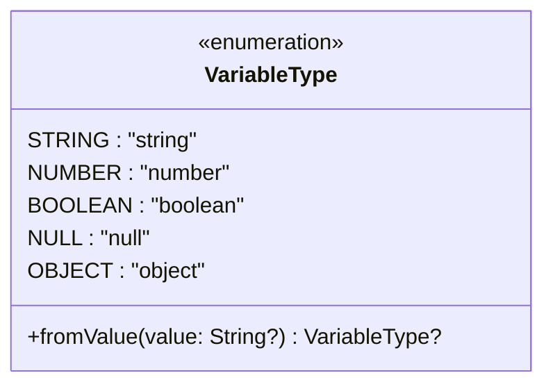
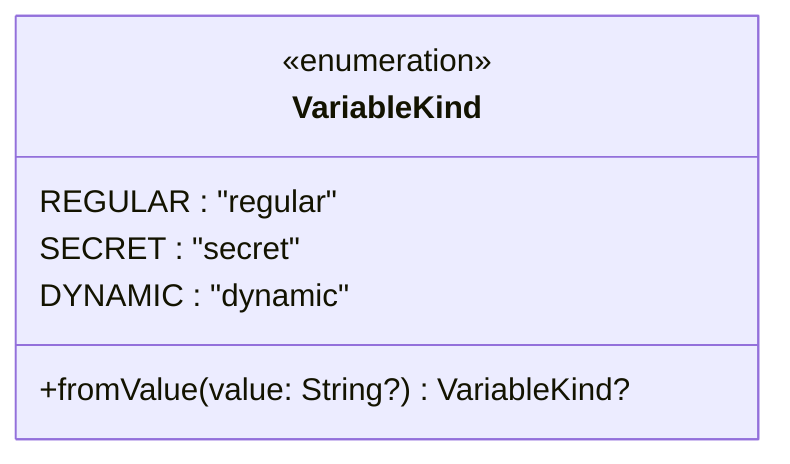
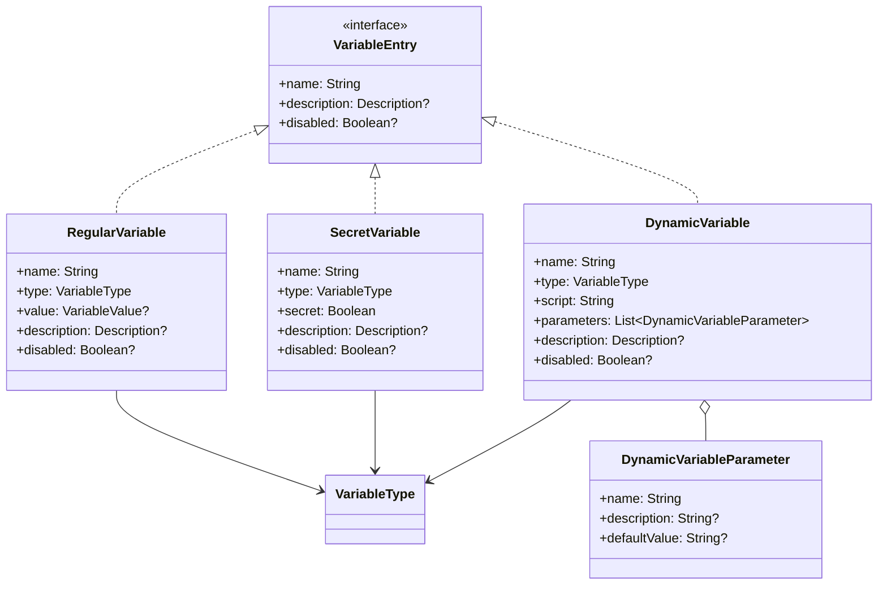

# Data Model: Typed Dynamic Variables & Variable Editor UI Modernization

**Feature Branch**: `028-typed-dynamic-variables` | **Date**: 2026-11-16 | **Spec**: [spec.md](spec.md)

---

## 1. Domain Entities & Enums

### VariableType (Data Type)
Represents the primitive data type of any variable (stored value for static variables, resolved secret for secrets, return type for dynamic variables).



### VariableKind (Execution Behavior)
Represents how the variable is resolved at runtime.



### VariableEntry Hierarchy (OpenCollection Domain)



---

## 2. UI Models (`ui-shared`)

### MutableKeyValue
The mutable backing object for variable table rows, param tables, and dialogs.

| Property | Type | Description |
|---|---|---|
| `key` | `String` | Variable identifier (e.g. `orderCount`) |
| `value` | `String` | Raw string value (for regular variables) |
| `enabled` | `Boolean` | Whether the variable is active |
| `secret` | `Boolean` | True if the variable is masked or externally fetched |
| `isDynamic` | `Boolean` | True if the variable is a dynamic JavaScript generator |
| `type` | `VariableType` | The data type (`STRING`, `NUMBER`, `BOOLEAN`, `OBJECT`) |
| `kind` | `VariableKind` | Derived or explicit kind accessor (`REGULAR`, `SECRET`, `DYNAMIC`) |
| `dynamicScript` | `String` | JavaScript generator source |
| `dynamicParameters` | `SnapshotStateList<DynamicVariableParameter>` | Declared parameters |
| `description` | `String` | Documentation tooltip |

```kotlin
var kind: VariableKind
    get() = when {
        isDynamic -> VariableKind.DYNAMIC
        secret -> VariableKind.SECRET
        else -> VariableKind.REGULAR
    }
    set(newKind) {
        when (newKind) {
            VariableKind.REGULAR -> { secret = false; isDynamic = false }
            VariableKind.SECRET -> { secret = true; isDynamic = false }
            VariableKind.DYNAMIC -> { secret = false; isDynamic = true }
        }
    }
```

---

## 3. Serialization Contracts (OpenCollection JSON & YAML)

### Dynamic Variable (JSON)
```json
{
  "name": "randomNumber",
  "type": "number",
  "script": "return Math.floor(Math.random() * 100);",
  "parameters": [],
  "description": "Generates a random integer between 0 and 99"
}
```

### Regular Variable (JSON)
```json
{
  "name": "pageSize",
  "type": "number",
  "value": "50"
}
```

### Secret Variable (JSON)
```json
{
  "name": "apiSecret",
  "secret": true,
  "type": "string"
}
```
