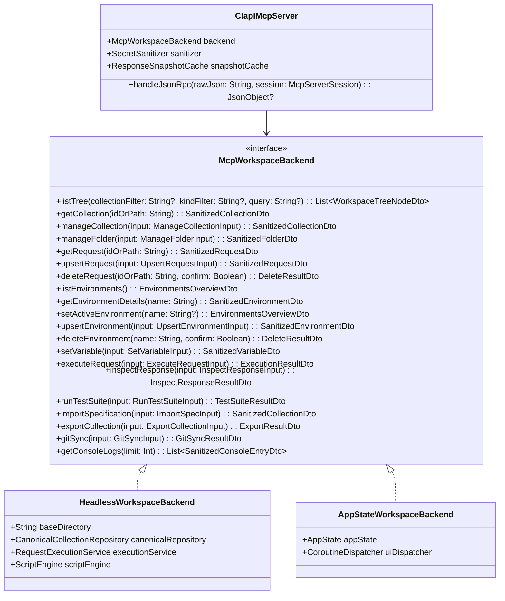

# Phase 1 Data Model: Clapi Model Context Protocol (MCP) Server

**Feature**: `029-mcp-server` | **Date**: 2026-11-18 | **Spec**: [spec.md](spec.md)

---

## 1. Module & Domain Architecture

---

## 2. Core Data Transfer Objects (DTOs) in `:mcp-server`

### 2.1 Workspace Hierarchy (`WorkspaceTreeNodeDto`)
Used by `clapi://tree` and `clapi_list_tree`.

| Field | Type | Description |
| :--- | :--- | :--- |
| `id` | `String` | Unique node UUID |
| `name` | `String` | Display name of the collection, folder, or request |
| `kind` | `String` | `"collection"`, `"folder"`, `"http"`, `"grpc"`, `"graphql"`, `"websocket"` |
| `method` | `String?` | HTTP method (`"GET"`, `"POST"`, etc.) or gRPC method type (`"unary"`), null for folders/collections |
| `url` | `String?` | Endpoint URL or template (omitted on folders/collections) |
| `slashPath` | `String` | Canonical path (e.g., `"Payments API/Users/Create User"`) |
| `children` | `List<WorkspaceTreeNodeDto>` | Nested folders and requests (empty for leaf requests) |

---

### 2.2 Sanitized Variable & Auth Representations

#### `SanitizedVariableDto`
Used across Global, Environment, Collection, Folder, and Request variable lists.

| Field | Type | Description |
| :--- | :--- | :--- |
| `key` | `String` | Variable name |
| `value` | `String` | Plaintext value for `regular`, `"********"` for `secret`, or `""` for `dynamic` |
| `kind` | `String` | `"regular"` \| `"secret"` \| `"dynamic"` |
| `variableType` | `String` | `"string"` \| `"number"` \| `"boolean"` \| `"object"` |
| `secret` | `Boolean` | True when `kind == "secret"` |
| `isSet` | `Boolean` | True if the underlying value or script is non-blank (allows agents to verify a secret is populated without reading its value) |
| `enabled` | `Boolean` | Whether the variable is enabled |
| `dynamicScript` | `String?` | JavaScript generator source when `kind == "dynamic"` |
| `dynamicParameters` | `List<DynamicVariableParameter>` | Declared parameters when `kind == "dynamic"` |
| `sourceEnvName` | `String?` | Populated in inherited environment projections |
| `isInherited` | `Boolean` | True if inherited from an ancestor environment via `extends` |
| `isOverridden` | `Boolean` | True if a local variable overrides an ancestor variable |

#### `SanitizedAuthDto`
Masks all credentials (`"********"`) while exposing structural configuration.

| Field | Type | Description |
| :--- | :--- | :--- |
| `type` | `String` | `"NONE"`, `"BASIC"`, `"BEARER"`, `"API_KEY"`, `"OAUTH2"`, `"JWT"`, `"INHERIT"` |
| `username` | `String?` | Visible username for Basic or OAuth2 Password flow |
| `password` | `String?` | Always `"********"` when non-blank |
| `token` | `String?` | Always `"********"` when non-blank (Bearer / JWT) |
| `apiKey` | `String?` | Header or query parameter name for API Key auth |
| `apiValue` | `String?` | Always `"********"` when non-blank |
| `apiPlacement` | `String?` | `"header"` \| `"query"` \| `"cookie"` |
| `oauth2Flow` | `String?` | `"client_credentials"`, `"authorization_code"`, `"password"`, `"implicit"` |
| `oauth2AccessTokenUrl` | `String?` | Token endpoint URL |
| `oauth2AuthorizationUrl` | `String?` | Authorization endpoint URL |
| `oauth2ClientId` | `String?` | Public client ID |
| `oauth2ClientSecret` | `String?` | Always `"********"` when non-blank |
| `oauth2Scope` | `String?` | Requested OAuth2 scopes |
| `isConfigured` | `Boolean` | True if the required secret/token field is non-blank in storage |

#### `SanitizedExternalSecretDeclarationDto`
Exposes environment-level external secret mapping metadata without any provider credentials or resolved values.

| Field | Type | Description |
| :--- | :--- | :--- |
| `name` | `String` | Variable reference name in Clapi |
| `providerType` | `String` | `"hashicorp-vault-server"`, `"aws-secrets-manager"`, `"azure-key-vault"`, `"gcp-secrets-manager"`, `"keeper-security-cloud"`, `"keepassxc"` |
| `path` | `String` | Vault path, AWS/Azure secret name, GCP secret ID, or Keeper record title |
| `url` | `String?` | Azure Vault name, GCP project ID, or KeePassXC entry URL |
| `targetField` | `String` | Extracted JSON field or record field (e.g., `"password"`) |
| `customFilters` | `Map<String, String>` | Non-sensitive custom filter attributes |
| `enabled` | `Boolean` | Whether declaration is active |

---

### 2.3 Sanitized Request Model (`SanitizedRequestDto`)

| Field | Type | Description |
| :--- | :--- | :--- |
| `id` | `String` | Request UUID |
| `name` | `String` | Request name |
| `slashPath` | `String` | Full hierarchical path (`"Collection/Folder/Request"`) |
| `collectionId` | `String` | Enclosing collection UUID |
| `parentFolderId` | `String?` | Enclosing folder UUID (null if at collection root) |
| `kind` | `String` | `"http"`, `"grpc"`, `"graphql"`, `"websocket"` |
| `summary` | `String?` | Optional request description/summary |
| `method` | `String?` | HTTP method (for `"http"`) |
| `url` | `String` | Request URL / endpoint |
| `queryParams` | `List<SanitizedKeyValueDto>` | Query parameters |
| `headers` | `List<SanitizedKeyValueDto>` | Headers (sensitive headers masked as `"********"`) |
| `auth` | `SanitizedAuthDto` | Sanitized authentication configuration |
| `bodyType` | `String?` | `"NONE"`, `"JSON"`, `"XML"`, `"HTML"`, `"JAVASCRIPT"`, `"FORM_DATA"`, `"X_WWW_FORM_URLENCODED"`, `"RAW_TEXT"`, `"BINARY"`, `"GRAPHQL"` |
| `bodyContent` | `String?` | Body payload text |
| `formDataEntries` | `List<FormDataEntryDto>` | Multipart or URL-encoded rows |
| `variables` | `List<SanitizedVariableDto>` | Request-scoped variables |
| `preRequestScript` | `String?` | Pre-request JavaScript source |
| `testScript` | `String?` | Post-request test JavaScript source |
| `grpc` | `GrpcRequestConfigDto?` | `protoFilePath`, `grpcMethod`, `grpcMethodType`, `metadata`, `message` (for `"grpc"`) |
| `graphql` | `GraphQlRequestConfigDto?` | `query`, `operationName`, `variablesJson`, `variants`, `settings` (for `"graphql"`) |
| `websocket` | `WebSocketRequestConfigDto?` | `messageFormat`, `timeout`, `keepAliveInterval`, `variants` (for `"websocket"`) |

---

### 2.4 Execution & Inspection Models

#### `ExecutionSnapshot` (In-Memory Cache Entry, LRU max 50 requests)
Stored in `ResponseSnapshotCache` **after** `SecretSanitizer.sanitizeExecutionResult(...)` has redacted sensitive headers and replaced all `knownSecretValues` (length ≥ 4) with `"[REDACTED_SECRET]"`.

| Field | Type | Description |
| :--- | :--- | :--- |
| `requestId` | `String` | Executed request UUID |
| `slashPath` | `String` | Executed request slash path |
| `executedAtEpochMillis` | `Long` | Execution timestamp |
| `statusCode` | `Int` | HTTP status code or gRPC status code |
| `statusText` | `String` | Status phrase |
| `contentType` | `String?` | Response MIME content type |
| `isBinary` | `Boolean` | True if content type is binary |
| `totalBytes` | `Long` | Total UTF-8 byte length (or raw binary byte length) |
| `sanitizedRequestHeaders` | `List<SanitizedKeyValueDto>` | Outgoing headers with sensitive headers masked |
| `sanitizedResponseHeaders` | `List<SanitizedKeyValueDto>` | Incoming headers with sensitive headers (`Set-Cookie`, etc.) masked |
| `sanitizedBodyText` | `String` | Full sanitized text body (empty if `isBinary == true`) |
| `metrics` | `ResponseMetrics` | Timing metrics (`responseTimeMs`, `ttfbMs`, `timeToFirstTokenMs`, etc.) |
| `assertions` | `List<AssertionResult>` | Post-request script test assertion results |
| `scriptLogs` | `List<String>` | Sanitized pre-request and post-request console output |
| `scriptError` | `String?` | Sanitized script failure message, if any |

#### `ExecutionResultDto` (Returned by `clapi_execute_request` and `clapi://responses/{requestId}/latest`)
Projects an `ExecutionSnapshot` with `bodyPreview` capped at `maxBodyLength` (default `4096` bytes), plus:
- `_truncated: Boolean`
- `_binary: Boolean`
- `_totalBytes: Long`
- `_hint: String?` (populated when `_truncated == true`)

---

### 2.5 Application Settings Additions (`AppSettings` & `SettingsRepository`)

| Property | Storage Key | Default | Description |
| :--- | :--- | :--- | :--- |
| `mcpServerEnabled` | `settings.mcpServerEnabled` | `false` | Whether the embedded Desktop HTTP MCP server starts automatically |
| `mcpServerPort` | `settings.mcpServerPort` | `3333` | Localhost port (`127.0.0.1`) for the embedded Desktop HTTP MCP server |

---

## 3. Validation & Invariant Rules

1. **Destructive Confirmation Invariant**: `clapi_manage_collection(action="delete")`, `clapi_manage_folder(action="delete")`, `clapi_delete_request`, and `clapi_delete_environment` MUST check `confirm == true`; if `false` or omitted, return an MCP tool error (`isError = true`) without modifying state.
2. **Environment Cycle Detection Invariant**: `clapi_upsert_environment` MUST verify via `isDescendantOf` / inheritance chain traversal that setting `extends = parentName` does not create a self-reference or cycle (`A -> B -> A`).
3. **Zero-Exfiltration Invariant**: No code path in `:mcp-server` may bypass `SecretSanitizer`. Secret variables (`kind == "secret"`), auth credentials, and external secret values are write-only from the MCP client's perspective.
4. **Disambiguation Invariant**: When a slash path matches `> 1` items, `NodeLookupResolver` MUST fail fast and list each matching item's `id`, `name`, `kind`, and `slashPath`.
