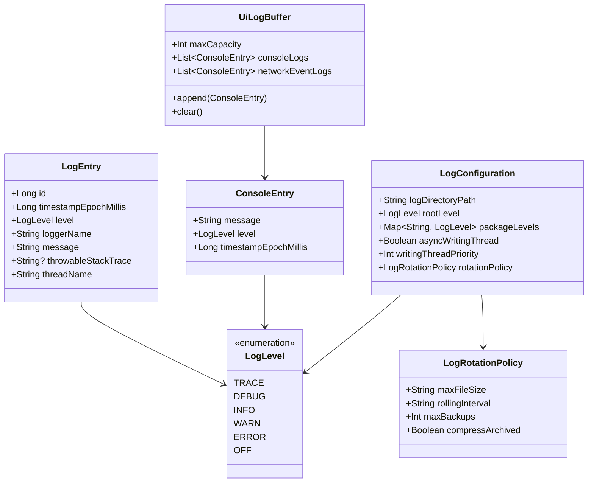
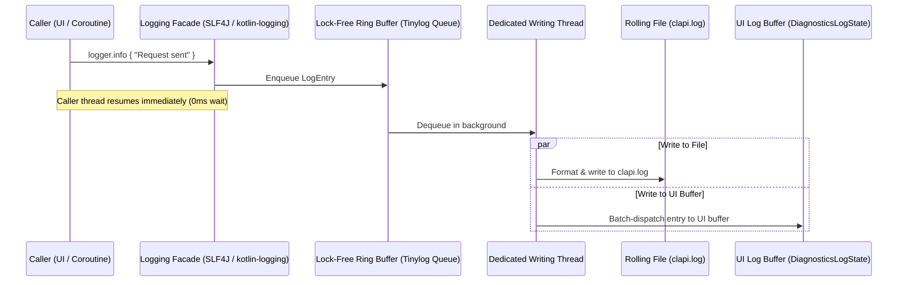

# Data Model: Asynchronous Persistent File & Diagnostics Logging

**Feature**: `030-async-file-logging`  
**Date**: 2026-11-18  
**Status**: Draft  

---

## 1. Entities & Data Structures

---

## 2. Entity Specifications

### 2.1 LogEntry
An immutable structured record produced by the logging system for every logged event.

| Field | Type | Description |
| :--- | :--- | :--- |
| `id` | `Long` | Unique monotonically increasing identifier for UI rendering keys. |
| `timestampEpochMillis` | `Long` | Epoch timestamp in milliseconds when the event was emitted. |
| `level` | `LogLevel` | Severity classification (`TRACE`, `DEBUG`, `INFO`, `WARN`, `ERROR`). |
| `loggerName` | `String` | Originating component or class tag (e.g. `App`, `Network`, `KtorApiClient`). |
| `message` | `String` | Human-readable log message text. |
| `throwableStackTrace` | `String?` | Optional serialized stack trace if an exception was provided. |
| `threadName` | `String` | Name of the thread or coroutine dispatcher where the call originated. |

### 2.2 ConsoleEntry (Existing UI Model)
The lightweight model rendered inside Compose UI `BottomPanel.kt`. Retained and adapted for backward compatibility.

| Field | Type | Description |
| :--- | :--- | :--- |
| `message` | `String` | Formatted log string displayed in the UI list row. |
| `level` | `LogLevel` | UI severity enum determining row accent color (info, warning, error, success). |
| `timestampEpochMillis` | `Long` | Timestamp for time display formatting (`HH:mm:ss.SSS`). |

### 2.3 LogRotationPolicy
Specification for managing on-disk rolling files and retention boundaries.

| Field | Type | Default Value | Description |
| :--- | :--- | :--- | :--- |
| `maxFileSize` | `String` | `"10mb"` | Maximum size before triggering a file rotation. |
| `rollingInterval` | `String` | `"daily"` | Date interval trigger (creates new archive on day rollover). |
| `maxBackups` | `Int` | `5` | Maximum number of historical archived files retained. |
| `compressArchived` | `Boolean` | `true` | Whether rotated archives are compressed into `.gz`. |

### 2.4 LogConfiguration
Runtime configuration driving Tinylog and SLF4J behavior.

| Field | Type | Description |
| :--- | :--- | :--- |
| `logDirectoryPath` | `String` | Absolute path to directory storing log files (`<storageDir>/logs`). |
| `rootLevel` | `LogLevel` | Minimum global severity threshold (`INFO`). |
| `packageLevels` | `Map<String, LogLevel>` | Component overrides (e.g., `io.ktor -> WARN`, `io.netty -> WARN`). |
| `asyncWritingThread` | `Boolean` | Enables asynchronous low-priority writing thread (`true`). |
| `writingThreadPriority`| `Int` | Thread priority (1 = `MIN_PRIORITY` to avoid UI contention). |

---

## 3. State Transitions & Lifecycle

### Logging Pipeline Flow

