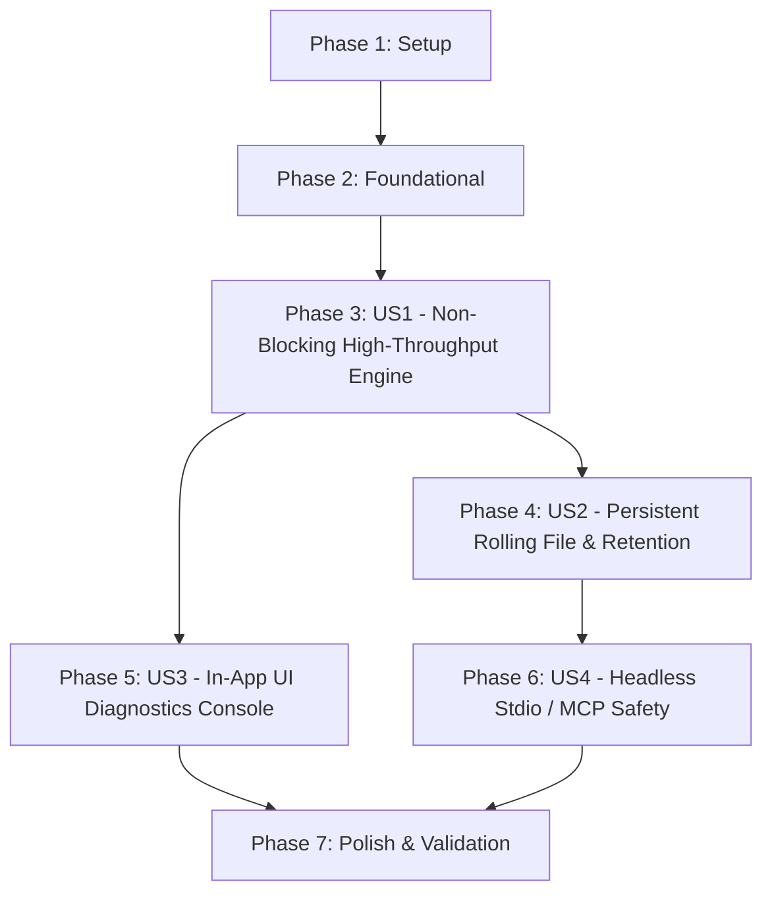

# Tasks: Asynchronous Persistent File & Diagnostics Logging

**Input**: Design documents from `/specs/030-async-file-logging/`  
**Prerequisites**: [plan.md](plan.md), [spec.md](spec.md), [research.md](research.md), [data-model.md](data-model.md), [contracts/logging-contract.md](contracts/logging-contract.md), [quickstart.md](quickstart.md)  

## Format: `- [ ] [TaskID] [P?] [Story?] Description with file path`

- **[P]**: Can run in parallel (different files, no dependencies)
- **[Story]**: Which user story this task belongs to (e.g., US1, US2, US3, US4)
- Descriptions include exact file paths

---

## Phase 1: Setup (Shared Infrastructure)

**Purpose**: Dependency configuration and build setup for Tinylog 2, SLF4J, and `kotlin-logging`.

- [ ] T001 Add Tinylog 2.8.1 (`tinylog-api`, `tinylog-impl`, `slf4j-tinylog`), SLF4J 2.0.17 (`slf4j-api`), and `kotlin-logging` 8.0.7 dependency definitions to `gradle/libs.versions.toml`
- [ ] T002 [P] Add `tinylog-api`, `tinylog-impl`, `slf4j-tinylog`, `slf4j-api`, and `kotlin-logging` dependencies to `ui-desktop/build.gradle.kts`
- [ ] T003 [P] Add `kotlin-logging` and `slf4j-api` dependencies to `ui-shared/build.gradle.kts`
- [ ] T004 [P] Add `kotlin-logging` and `slf4j-api` dependencies to `core-network/build.gradle.kts`

---

## Phase 2: Foundational (Blocking Prerequisites)

**Purpose**: Core logging facade, SPI definitions, and base configuration required before implementing user stories.

- [ ] T005 Implement common multiplatform `AppLogging` facade object in `core-network/src/commonMain/kotlin/io/github/makeforge/clapi/core/logging/AppLogging.kt`
- [ ] T006 [P] Implement `Slf4jNetworkLogger` adapter in `core-network/src/commonMain/kotlin/io/github/makeforge/clapi/core/network/Slf4jNetworkLogger.kt` implementing `NetworkLogger`
- [ ] T007 [P] Create base `tinylog.properties` with `writingthread = true`, `writingthread.priority = 1`, and package level dampeners (`io.ktor = warn`, `io.netty = warn`) in `ui-desktop/src/desktopMain/resources/tinylog.properties`
- [ ] T008 [P] Add ProGuard keep rules for `org.tinylog.**` and custom writers in `ui-desktop/proguard-rules.pro`

**Checkpoint**: Core dependencies, facade, and foundational configuration ready. User story implementation can now proceed.

---

## Phase 3: User Story 1 - Non-Blocking High-Throughput Diagnostic Logging (Priority: P1) 🎯 MVP

**Goal**: Guarantee that high-frequency diagnostic logging executes asynchronously off the UI thread without causing UI stutter, frame drops, or blocking request dispatching.

**Independent Test**: Run `LoggingPerformanceBenchmarkTest` verifying 10,000 log events dispatched across 10 concurrent threads complete with < 0.05 ms caller-thread overhead and zero EDT thread contention.

### Tests for User Story 1

- [ ] T009 [P] [US1] Create benchmark test in `ui-desktop/src/desktopTest/kotlin/io/github/makeforge/clapi/ui/desktop/logging/LoggingPerformanceBenchmarkTest.kt` verifying asynchronous non-blocking throughput (> 1,000 logs/sec, < 0.05 ms enqueue overhead)

### Implementation for User Story 1

- [ ] T010 [US1] Connect `Slf4jNetworkLogger` to `KtorApiClient` and `NetworkDiModule` as default logger in `core-network/src/commonMain/kotlin/io/github/makeforge/clapi/core/network/NetworkDiModule.kt`
- [ ] T011 [US1] Configure Tinylog lock-free queue buffer sizing in `ui-desktop/src/desktopMain/resources/tinylog.properties` to absorb high-frequency streaming bursts

**Checkpoint**: User Story 1 is functional and verifiable independently. Callers emit logs without blocking main execution threads.

---

## Phase 4: User Story 2 - Persistent Rolling File Logging & Retention (Priority: P1)

**Goal**: Persist all diagnostic logs to a rotating on-disk file (`<storageDir>/logs/clapi.log`) with 10 MB size and daily calendar boundaries, gzip compression, bounded retention (5 backups), and fatal crash reporting.

**Independent Test**: Run `LogFileRollingIntegrationTest` and `CrashHandlerIntegrationTest` to verify file creation on disk, automatic rolling, gzip compression, 5-archive retention limit, and fatal crash capture.

### Tests for User Story 2

- [ ] T012 [P] [US2] Create rolling file integration test in `ui-desktop/src/desktopTest/kotlin/io/github/makeforge/clapi/ui/desktop/logging/LogFileRollingIntegrationTest.kt` verifying file creation, size-based rotation at 10 MB, and retention pruning capped at 5 backups
- [ ] T013 [P] [US2] Create crash handler integration test in `ui-desktop/src/desktopTest/kotlin/io/github/makeforge/clapi/ui/desktop/logging/CrashHandlerIntegrationTest.kt` verifying uncaught JVM exceptions are flushed to disk before exit

### Implementation for User Story 2

- [ ] T014 [US2] Implement `LogDirectoryConfigurator` in `ui-desktop/src/desktopMain/kotlin/io/github/makeforge/clapi/ui/desktop/logging/LogDirectoryConfigurator.kt` resolving `<storageDir>/logs/`, setting `clapi.log.dir` system property, and installing `Thread.setDefaultUncaughtExceptionHandler`
- [ ] T015 [US2] Hook `LogDirectoryConfigurator.configure(args)` and JVM shutdown flush in `ui-desktop/src/desktopMain/kotlin/io/github/makeforge/clapi/ui/desktop/Main.kt` before Compose application launch
- [ ] T016 [US2] Configure rolling file writer (`writer2 = rolling file`, `file = ${clapi.log.dir}/clapi.{date:yyyy-MM-dd}.{count}.log`, `latest = ${clapi.log.dir}/clapi.log`, `policies = daily, size: 10mb`, `backups = 5`, `convert = gzip`) in `ui-desktop/src/desktopMain/resources/tinylog.properties`

**Checkpoint**: User Stories 1 AND 2 are complete. Logs are persisted to disk asynchronously and rotated automatically without unbounded storage growth.

---

## Phase 5: User Story 3 - Live In-App Diagnostics Console & Easy Log Access (Priority: P2)

**Goal**: Provide live log visualization in Clapi's in-app bottom diagnostics panel without per-message UI recomposition thrashing, and provide a one-click button to reveal the log directory in the operating system's native file explorer.

**Independent Test**: Verify diagnostic logs appear in the bottom panel Console tab, verify UI filter updates, and click "Open Log Folder" to confirm the OS native file manager opens to `<storageDir>/logs`.

### Tests for User Story 3

- [ ] T017 [P] [US3] Create UI log writer integration test in `ui-desktop/src/desktopTest/kotlin/io/github/makeforge/clapi/ui/desktop/logging/UiDiagnosticsLogWriterTest.kt` verifying background-to-UI dispatching and batching

### Implementation for User Story 3

- [ ] T018 [US3] Implement `UiDiagnosticsLogWriter` in `ui-desktop/src/desktopMain/kotlin/io/github/makeforge/clapi/ui/desktop/logging/UiDiagnosticsLogWriter.kt` implementing `org.tinylog.writers.Writer` and register via `ui-desktop/src/desktopMain/resources/META-INF/services/org.tinylog.writers.Writer`
- [ ] T019 [US3] Implement `UiLogDispatcher` in `ui-desktop/src/desktopMain/kotlin/io/github/makeforge/clapi/ui/desktop/logging/UiLogDispatcher.kt` to safely batch and dispatch log entries to `DiagnosticsLogState` on `Dispatchers.Main`
- [ ] T020 [US3] Update `AppState.log` and `AppState.logNetworkEvent` in `ui-shared/src/commonMain/kotlin/io/github/makeforge/clapi/ui/shared/state/AppState.kt` to route through `AppLogging`
- [ ] T021 [US3] Add "Open Log Folder" icon action button to the diagnostics toolbar in `ui-shared/src/commonMain/kotlin/io/github/makeforge/clapi/ui/shared/components/BottomPanel.kt` using `java.awt.Desktop.getDesktop().open(logDir)`

**Checkpoint**: User Stories 1, 2, and 3 are functional. The in-app UI diagnostics panel displays live logs seamlessly with quick access to the persistent folder.

---

## Phase 6: User Story 4 - Headless & Stdio Protocol Isolation (Priority: P2)

**Goal**: Guarantee that diagnostic logs in headless Stdio mode (`--mcp`) never write to standard output (`stdout`), directing console output strictly to `stderr` and preventing JSON-RPC protocol corruption.

**Independent Test**: Run `McpStdioLoggingIsolationTest` launching Clapi with `--mcp`, sending an `initialize` JSON-RPC request, and verifying `stdout` contains strictly JSON-RPC protocol frames while diagnostic logs route to `stderr` and disk.

### Tests for User Story 4

- [ ] T022 [P] [US4] Create Stdio MCP logging isolation test in `ui-desktop/src/desktopTest/kotlin/io/github/makeforge/clapi/ui/desktop/logging/McpStdioLoggingIsolationTest.kt` verifying 100% clean `stdout` during `--mcp` execution

### Implementation for User Story 4

- [ ] T023 [US4] Configure `writer1.stream = err` in `ui-desktop/src/desktopMain/resources/tinylog.properties` ensuring console output strictly routes to standard error
- [ ] T024 [US4] Update `StdioMcpServerRunner` in `mcp-server/src/commonMain/kotlin/io/github/makeforge/clapi/mcp/server/transport/StdioMcpServerRunner.kt` to ensure logging configuration completes before initializing protocol I/O streams

**Checkpoint**: All user stories are complete. Headless MCP stdio execution is protected against log contamination.

---

## Phase 7: Polish & Cross-Cutting Concerns

**Purpose**: Cleanup, documentation, and end-to-end scenario validation.

- [ ] T025 [P] Remove unused `ktor-client-logging` dependencies from `gradle/libs.versions.toml`, `core-network/build.gradle.kts`, and `ui-shared/build.gradle.kts`
- [ ] T026 [P] Update architecture documentation in `docs/reference/architecture.md` describing the asynchronous Tinylog + SLF4J logging architecture, rolling file policies, and UI integration
- [ ] T027 Execute all validation scenarios from `specs/030-async-file-logging/quickstart.md` to confirm end-to-end functionality

---

## Dependencies & Execution Order

### Phase Dependencies

- **Setup (Phase 1)**: No dependencies - can start immediately.
- **Foundational (Phase 2)**: Depends on Setup (Phase 1) - BLOCKS all user stories.
- **User Story 1 (Phase 3 - P1)**: Depends on Phase 2. Core MVP.
- **User Story 2 (Phase 4 - P1)**: Depends on Phase 2 and US1 core setup.
- **User Story 3 (Phase 5 - P2)**: Depends on Phase 2 and US1/US2.
- **User Story 4 (Phase 6 - P2)**: Depends on Phase 2 and US2.
- **Polish (Phase 7)**: Depends on completion of all user story phases.

### User Story Dependencies



### Parallel Opportunities

- **Phase 1 (Setup)**: T002, T003, and T004 can run in parallel after T001.
- **Phase 2 (Foundational)**: T006, T007, and T008 can run in parallel after T005.
- **User Story 1**: T009 (test) can run in parallel with preparatory tasks.
- **User Story 2**: T012 and T013 (tests) can be created in parallel.
- **User Story 3**: T017 (test) can run in parallel.
- **User Story 4**: T022 (test) can run in parallel.
- **Polish**: T025 and T026 can run in parallel.

---

## Parallel Example: User Story 2

```bash
# Launch tests for User Story 2 together:
Task: "Create rolling file integration test in ui-desktop/src/desktopTest/kotlin/io/github/makeforge/clapi/ui/desktop/logging/LogFileRollingIntegrationTest.kt"
Task: "Create crash handler integration test in ui-desktop/src/desktopTest/kotlin/io/github/makeforge/clapi/ui/desktop/logging/CrashHandlerIntegrationTest.kt"

# Then implement configurator and properties:
Task: "Implement LogDirectoryConfigurator in ui-desktop/src/desktopMain/kotlin/io/github/makeforge/clapi/ui/desktop/logging/LogDirectoryConfigurator.kt"
Task: "Configure rolling file writer in ui-desktop/src/desktopMain/resources/tinylog.properties"
```

---

## Implementation Strategy

### MVP First (User Story 1 Only)
1. Complete Phase 1: Setup (T001–T004)
2. Complete Phase 2: Foundational (T005–T008)
3. Complete Phase 3: User Story 1 (T009–T011)
4. **Validate MVP**: Run `LoggingPerformanceBenchmarkTest` to verify asynchronous non-blocking throughput.

### Incremental Delivery
1. Add User Story 2: Enable persistent rolling file writing, rotation, and crash handling on disk.
2. Add User Story 3: Enable the live in-app bottom diagnostics panel bridge and "Open Log Folder" action.
3. Add User Story 4: Verify headless Stdio MCP isolation ensuring `stdout` cleanliness.
4. Execute Phase 7 Polish and Quickstart scenarios.
